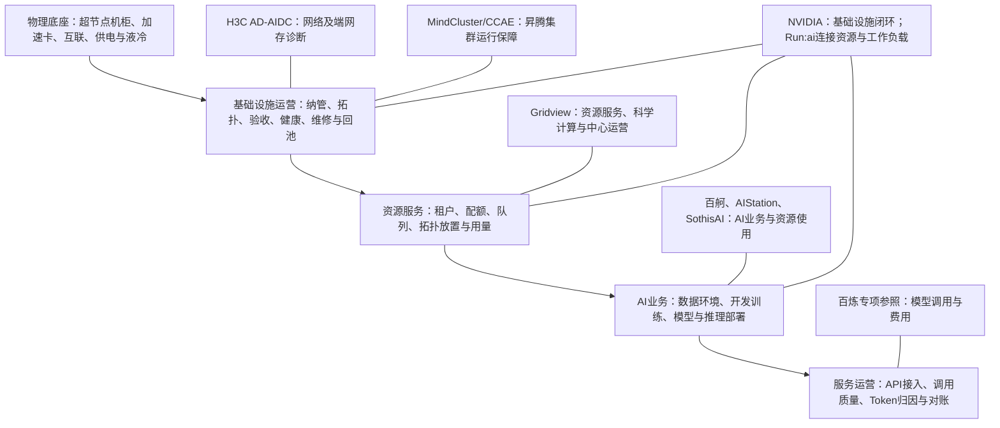
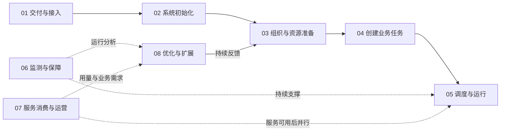
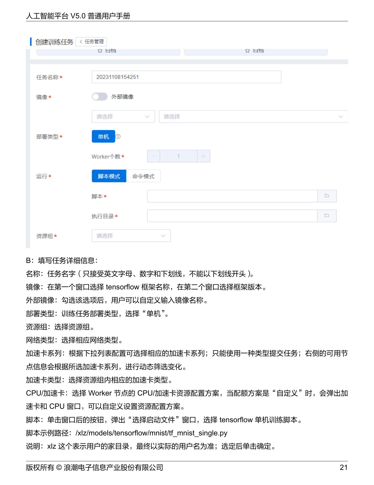
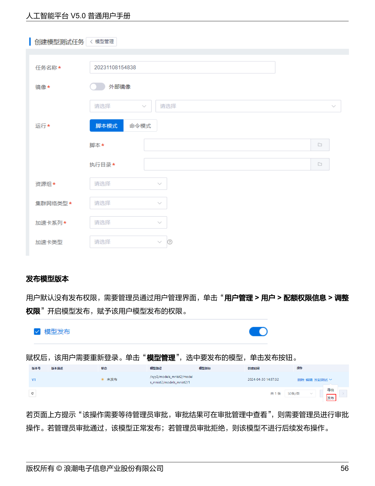
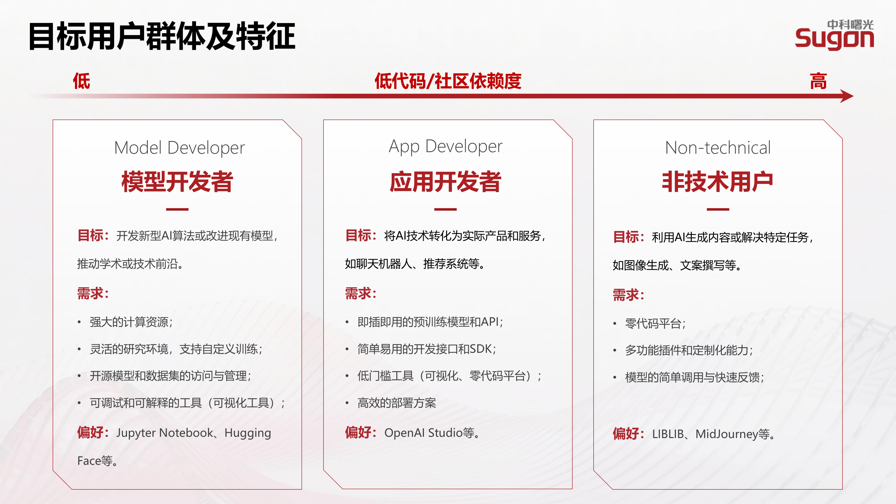
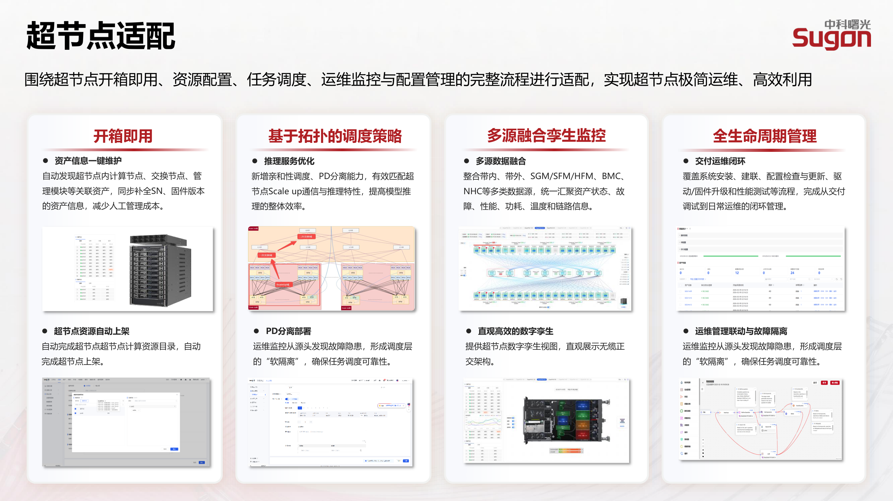

# 超节点平台竞争分析

2026-10-15 · 基于项目资料、竞品原始截图及官方公开研究 · 桌面研究版

## 01 先看结论：产品层次与侧重

**我们的竞争重点应是：把超节点从“设备已上线”变成“业务跑得稳、资源用得清、费用能核对”的统一工作平台。** 这是结合MRD整理的产品定位建议，实际能力与交付范围待确认。

本地材料覆盖七组主要分析对象：NVIDIA Mission Control、H3C UniPoD/AD-AIDC、华为 MindCluster/CCAE、百度百舸、Gridview 7、AIStation、SothisAI；另外把 H3C 灵犀 Base 作为同厂商另一条产品线单独分析。补充百炼和华为云 IAM/CTS，分别作为Token消费运营与授权审计的专项参考。

| 对象 | 一句话定位 | 主要侧重 | 对我们的比较意义 |
|---|---|---|---|
| NVIDIA Mission Control | NVIDIA AI 基础设施的交付与持续运营软件栈 | 基线验收、硬件恢复、作业恢复、资源和功耗管理 | 对照“可交付、可恢复”的系统闭环；Run:ai 是栈内独立组件 |
| H3C UniPoD + AD-AIDC | 超节点硬件底座配合智算基础设施管控与分析 | 网络自动化、端网存关联、训前巡检、通信诊断 | 对照训练性能排障；UniPoD为硬件产品，AD-AIDC为管控软件 |
| 华为 MindCluster + CCAE | 昇腾集群基础软件与集群管控运维的协同体系 | NPU 集群、算网存健康、训练可靠性与推理观测 | 对照国产算力运行保障；MindCluster与CCAE按独立组件研究 |
| 百度百舸 | 面向 AI 工作负载的计算与资源管理平台 | 资源池和队列、开发训练、故障诊断、推理与用量 | 对照模型团队从资源到结果的日常工作链 |
| 曙光 Gridview 7 | 算力中心统一调度、监控和服务入口 | 多层监控、科学计算任务、算力服务与运营 | 对照 AI 与 HPC 混合服务；公测截图与官方图分开 |
| AIStation V5.0 | 从开发到训练、模型与服务的 AI 生产平台 | 数据、环境、训练、模型服务与团队管理 | 对照普通用户任务流程及团队管理；以本地 V5.0 为界 |
| 曙光 SothisAI V3.2 | AI 开发、训推及应用服务一体化平台 | 开发训练、超节点适配、模型服务、网关与应用 | 对照 AI 业务工作台；与 Gridview 同属曙光，不当互斥方案 |
| H3C 灵犀 Base E0601 | AI 平台的基础资源与租户管理组件 | 集群、资源池、租户、资源组、资产与权限 | 对照开通与授权；Base 手册不能代表灵犀全部训推能力 |

表内定位为综合归纳，逐家证据和官方链接见后文研究附录。**没有一种“看起来功能最多”的页面可以直接代表综合竞争力。** 需要看它是否把同一用户任务中的前后状态连起来。

## 02 研究范围与证据怎么读

本报告回答五个问题：各家重点是什么；谁在用；用户怎样完成任务；页面如何支持判断和交接；我们的产品应先做好什么。

| 证据类别 | 本次怎么使用 | 不能据此认定什么 |
|---|---|---|
| 项目需求 | 本地 MRD 原工作簿共 17 个工作表、395 行非空记录；对照已有提取记录 | 作为项目需求依据，实际实现与竞品证据分别核实 |
| 项目流程与设计 | 角色总流程、Obsidian 已保存的访谈摘要和 Figma 学习笔记 | 未重新逐节点读取在线 Figma；不声称核验全部原始访谈或嵌入图片 |
| 官方手册截图/官方演示帧 | 说明可观察的字段、入口、状态和局部操作 | 不证明同一客户、同一版本跑通了完整旅程 |
| 官方产品介绍/白皮书/发布说明 | 解释定位、能力与版本条件 | 宣传收益不当作独立实测结果 |
| 厂商署名转载/第三方公测 | 补充 Gridview 等缺少公开界面的环节，并降低证据强度 | 不当作官方完整功能承诺 |
| 研究推断 | 用户职责归类、预计频率、流程衔接、体验阻力和产品建议 | 不编造访问量、满意度、情绪曲线和评分 |

“核心”表示决定产品价值；“预计高频”表示稳定运行期会重复发生，尚无访问日志或用户调研确认。交付、换件、漏液处置可能不高频，但对业务风险极其重要。研究中的角色数量按职责分类；官方账号、角色和门户设置另行核实。

原始材料保留在 `参考资料/`；NVIDIA 以“截图修订版”为主，旧图集只留作历史，不重复计数。完整截图证据目录见报告末尾，每张图保留原来源和版本提醒；新增手册/PPT 页面单列。未登录各家真实集群，没有测步骤耗时、性能、恢复成功率或现场使用体验。

### 全部资料的处理边界

| 材料 | 处理方式 |
|---|---|
| 各平台截图目录、图解、索引和校验记录 | 分产品研究，保留来源；从旅程选择关键图，附全部有效索引 |
| AIStation V5.0、H3C 灵犀 Base 手册 | 文本阅读与关键页证据提取 |
| SothisAI V3.2 PPT | 提取原版页面并核对功能介绍；整页宣传图与真实 UI 局部区别使用 |
| Gridview 本地视频与已有图集 | 本地视频长129.518秒，抽查12.95/45.33/84.19/116.57秒：为Gridview 7.0宣传讲解与展示画面；操作细节以可追溯图集取证 |
| MRD 工作簿与提取记录 | 核对范围、角色、场景、需求编号与未决项；技术指标保留为目标 |
| 项目流程、Figma/访谈学习笔记 | 作为项目语境和已有设计提案，不拿来证明竞品能力 |
| 根目录两张 PNG | 前期记录已检查：生活类移动端拼图与基本空白图，与本次竞品业务无关 |

## 03 产品定位地图：从硬件到业务的五层

此图显示本轮材料中的产品重心；完整功能范围按对应资料核实。硬件层的NVLink、H3C互联、昇腾互联机制各有特点，替换适用性需分别验证。

MindCluster 提供可集成的调度与恢复底层组件，CCAE 提供健康评估、运维与开放能力；两者分别取证，不拼成同一个控制台。

| 同一采购/设计问题 | 优先对照对象 | 比较重点 |
|---|---|---|
| 新机柜能否快速验收并交付？ | Mission Control、H3C、CCAE | 自动发现、基线、失败定位、报告和移交 |
| 任务为什么等待或跑得慢？ | 百舸、Run:ai、AD-AIDC、MindCluster | 队列原因、拓扑约束、端网存诊断与责任分派 |
| 模型团队能否完成日常工作？ | 百舸、AIStation、SothisAI | 准备、提交、观察、结果留存与部署 |
| 存量 AI/HPC 资源如何统一服务？ | Gridview、Run:ai 等资源管理能力 | 资源类型、队列、公平性、任务环境与计量 |
| 推理怎样变成可消费可核对的服务？ | 百炼专项、SothisAI、百舸 | 授权凭据、服务质量、用量归属与费用口径 |
| 用户权力如何分开、操作如何追查？ | 灵犀 Base、华为云 IAM/CTS 专项 | 主体、范围、动作、结果和审计留存；不等同完整三员合规 |

## 04 谁在用：项目用户分组与各平台侧重

MRD 明确列出六类核心职责，另有业务方/财务扩展只读职责。智算系统用户内部再区分训练开发和服务部署两条旅程；交付和设施作为服务协作职责补充，不据此增加系统内预置账号。

| 项目职责 | 要完成什么 | 反复需要回答的问题 | 主要参照 |
|---|---|---|---|
| 智算系统用户：模型开发/算法 | 开发、训练、微调并交付产物 | 为什么排队、运行是否有效、产物能否复现？ | 百舸、AIStation、SothisAI、Run:ai |
| 智算系统用户：服务负责人 | 部署推理并保障调用 | 实例就绪了吗、延迟为何升高、版本如何切换？ | 百舸、SothisAI、Run:ai |
| 系统管理员 | 管资源、调度、资产与运行 | 哪些资源可用、哪些业务受影响、何时回池？ | Mission Control、CCAE、AD-AIDC |
| 安全管理员 | 管账户、授权与安全策略 | 谁能对哪些对象做什么、互斥和复核是否满足？ | 灵犀 Base、IAM；本项目三员规则以 MRD 为准 |
| 安全审计员 | 独立调查操作与导出证据 | 谁在何时改变什么、结果如何、证据是否完整？ | 华为云 CTS 专项 |
| 运营管理员 | 管配额、价格、用量与费用归属 | 哪个租户/部门/应用在消耗、对账差异在哪？ | Gridview、百炼、AIStation、SothisAI |
| Token 消费者/平台对接方 | 接入 API，消费推理并读取用量 | 凭据、模型、地域、限流和账单是否正确？ | 百炼消费专项；各平台对接角色与权限分别核实 |
| 业务方/财务（扩展） | 只读核对用量和费用 | 金额如何计算、归谁、是否需要异议处理？ | 百炼、AIStation 的用量/账单结构 |
| 交付/设施协作职责 | 验收交付、设施排障与现场维修 | 哪个位置、交给谁、复测依据是什么？ | Mission Control、H3C、项目访谈摘要 |

各家的分析角色分组数量见独立研究附录。不同报告合并职责的粒度不同，数字不可用来判断谁覆盖更多用户。我们的“双 Portal”应是业务与管理入口的组织方式；三员、运营与财务仍按职责授权，不允许为了统一入口合并互斥权限。

### 每个平台分别有几类用户

下表把同一人可能兼任的职责拆开，供产品设计使用；只有“材料明确”一列可视为文档实际角色口径。业务使用者通过应用间接使用算力，不一定登录平台管理端。

| 对象 | 本报告分析分组数量 | 分别是谁 | 材料明确与限制 |
|---|---|---|---|
| Mission Control整体栈 | 5类 | 交付部署、平台资源、模型工程、硬件运维、设施能源 | 栈内按组件独立授权；五类按分析职责划分 |
| H3C AD-AIDC | 4类 | 交付部署、日常运维、网络/存储专家、业务协同负责人 | 依据页面任务归纳；业务方不一定直接操作该控制台 |
| MindCluster/CCAE相关体系 | 5类 | 交付、集群运维、性能专家、平台集成开发、训练/推理负责人 | MindCluster集成开发者尤其重要；非同一门户五种角色 |
| 百舸 | 4类 | 平台资源管理员、模型开发者、推理服务负责人、团队/运营负责人 | 按任务归纳，权限管理员可由平台或团队职责承担 |
| Gridview 7 | 4类 | 中心资源管理员、运维、科研/AI计算用户、服务运营负责人 | 公测和宣传材料没有提供可确认的完整角色清单 |
| AIStation V5.0 | 4种手册角色 | 普通用户、组管理员、审计员、系统管理员 | 手册物理第11页；普通用户可再按开发/训练/服务任务细分 |
| SothisAI V3.2 | 3类业务用户＋2类保障职责 | 模型开发者、应用开发者、非技术业务用户；平台资源、运维运营 | 前三类由P5明确，后两类按P7/P9及组合运维材料归纳 |
| H3C灵犀Base | 3类手册角色 | 系统管理员、租户管理员、普通用户 | 按平台、租户与个人划分权限层级；本项目三员职责另行设计 |
| 百炼专项 | 3类分析职责 | 空间/访问管理、应用API开发消费、用量费用管理 | 仅覆盖本轮消费旅程，不枚举所有官方角色 |
| IAM/CTS专项 | 3类分析职责 | 授权管理、被授权操作者、审计调查者 | 分析分工，不声称它已实现本项目三员互斥规则 |

## 05 核心场景与预计高频场景

| 场景 | 主要使用者 | 使用节奏（研究推断） | 用户的完成标准 | 主要竞品 |
|---|---|---|---|---|
| 规划与方案评审 | 客户、架构师、设施/网络 | 首建/扩容触发，低频高价值 | 方案、约束与验收目标被确认 | NVIDIA规划指南与项目访谈提供主要依据 |
| 上电部署与验收移交 | 交付、系统管理员 | 首建、扩容或大变更集中 | 基线、健康、性能达标并有报告 | Mission Control、H3C |
| 成员授权与资源开通 | 安全、运营、团队/系统管理 | 新成员/项目和额度变化触发 | 权限生效、资源绑定、环境可用 | 灵犀 Base、Run:ai、百舸、AIStation |
| 开发、训练和微调 | 模型开发者 | 预计日常高频；迭代反复 | 完成评估、登记产物与运行条件 | 百舸、AIStation、SothisAI |
| 推理部署与调用 | 服务负责人、Token 消费者 | 调用持续；部署和变更按需 | 实例就绪、可授权调用、质量达标 | 百舸、SothisAI、百炼 |
| 任务观察与排障 | 开发者、平台/网络运维 | 预计日常高频；排障事件触发 | 定位责任并恢复业务 | 百舸、AD-AIDC、CCAE、Mission Control |
| 健康巡检与计划维护 | 平台/现场运维 | 监控持续、巡检周期、维护按需 | 验证后恢复可调度，业务复核通过 | Mission Control、H3C、CCAE |
| 液冷/供电风险处置 | 设施、系统管理、业务方 | 监控持续；重大事件低频 | 风险受控、现场复核、恢复授权明确 | Mission Control BCM/DPS；项目现场资料 |
| 用量、费用与容量复盘 | 运营、团队、财务 | 用量持续、账期核对周期发生 | 用量可归因、账单可解释、调整有依据 | Gridview、AIStation、百炼、SothisAI |
| 授权变更与独立审计 | 安全、审计 | 授权按需、审计持续/周期 | 主体权限合规、操作证据可追溯 | IAM/CTS 专项，灵犀 Base |

频率不能只用“点得多”衡量：告警列表可以每天查看，但决定产品价值的是能否从告警定位受影响任务并完成恢复。上表为研究判断，频率统计与正式排期需真实用户和日志验证。

## 06 用户旅程总图：八个阶段，主流程与并行支撑

01–05 为主业务流程；06 在系统运行与任务执行中持续支撑，07 在相关服务可用后并行开展；08 根据监测、用量与业务需求持续反馈。阶段编号是业务分类，不等于所有用户必须严格执行的顺序。

已有平台的新成员可从组织与资源准备进入，应用凭据主体可按授权调用已有服务。资源使用分析、策略配置与扩展规划按 MRD 支持及演进范围推进，不表示扩容已完成。下面按角色拆分具体任务，不改变竞品材料中的真实流程。

### 旅程 A：交付工程师把设备交成可用资源

[直接查看对应页面图解](#journey-delivery)

| 阶段 | 目标与动作 | 触点/截图证据 | 用户疑问/推定阻力 | 交接与机会 |
|---|---|---|---|---|
| 方案确认 | 明确负载、容量、供电与冷却约束 | 官方部署规划文档；本轮无竞品控制台图 | 交付前哪些条件未满足？ | 确认验收标准；保留服务流程文字节点 |
| 纳管部署 | 发现设备、配置网络和 Agent | H3C 01、04、05 | 设备在线是否等于可交付？ | 资产、位置、版本形成同一记录 |
| 基线检查 | 对照拓扑、环境与性能标准 | Mission Control AHR 03、07；H3C 07 | 哪一项失败、影响哪些资源？ | 检查结果必须可下钻 |
| 整改复验 | 定位失败、修复后重新验证 | Mission Control AHR 09、10 | 失败与未执行是否被误算通过？ | 同一验收批次保留全部尝试 |
| 验收移交 | 发布报告、明确维护责任 | Mission Control AHR 08 | 报告是何时、针对哪批资产？ | 移交给系统管理再开放资源 |

关键时刻：**正式报告发布不应掩盖失败或待执行项。** 页面图解见下方“交付与恢复”证据组。

### 旅程 B：模型开发者完成一轮训练/微调

[直接查看对应页面图解](#journey-training)

| 阶段 | 目标与动作 | 触点/截图证据 | 用户疑问/推定阻力 | 完成与交接 |
|---|---|---|---|---|
| 获得环境 | 进入项目，确认配额、数据与镜像 | 百舸 03、06、07；AIStation 手册；Run:ai 02、03 | 有额度为什么仍不能用？ | 明确权限、配额、健康容量、环境四类条件 |
| 配置任务 | 绑定数据/模型版本、框架与资源 | 百舸 08；SothisAI 训练页；AIStation 训练页 | 参数、存储和运行时是否兼容？ | 提交前指出具体缺项和处理人 |
| 排队和训前检查 | 等待满足调度及健康条件 | 百舸 09、13；H3C 07、08 | 等待的是资源、健康还是配置？ | 分别展示排队与检查状态 |
| 运行观察 | 看训练效果与资源/通信指标 | 百舸 10、11；H3C 09、13 | loss 异常还是硬件拖慢？ | 任务关联到卡、节点和通信路径 |
| 异常恢复 | 查诊断、检查点与恢复记录 | 百舸 14、15、16；NVIDIA AJR 01 | 重试会丢多少进度、是否仍有坏资源？ | 作业恢复和硬件维修分别追踪 |
| 评估交付 | 比较结果，登记模型与环境 | 百舸 27、29；AIStation/SothisAI 模型管理 | 能复现、能供部署吗？ | 形成模型版本，转服务负责人或留存成果 |

这是综合旅程参照，不代表把上述不同平台串成了一条已经跑通的链路。预计最常重复的是配置—运行—评估；恢复是高影响事件。情绪未调研，用“用户疑问/阻力”表达可检验假设，不画虚构满意度曲线。

### 旅程 C：服务负责人部署推理，消费者接入

[直接查看对应页面图解](#journey-inference)

| 阶段 | 目标与动作 | 触点/截图证据 | 用户疑问/推定阻力 | 完成与交接 |
|---|---|---|---|---|
| 选择模型与部署 | 确认版本、引擎、卡数与服务配置 | 百舸 17、18；SothisAI 13、14 | PD 分离何时适用、配置是否兼容？ | 技术能力转成可选规格与适用条件 |
| 实例就绪与压测 | 核对就绪实例、时延和吞吐 | 百舸 17、19、20、22；22仅压测条件页，完整结果待核 | 部署完成是否真正可调用？ | 区分部署完成、实例健康、业务验证 |
| 应用接入 | 授权模型、签发凭据、配置入口 | 百炼 API Key 官方步骤；SothisAI 网关页 | 控制台权限是否等于调用权限？ | 凭据绑定主体、空间、地域和模型范围 |
| 持续调用 | 监控成功率、首 Token 时延及限流 | CCAE 11、12为宣传片观测示例；百炼监控文档，不据此证明CCAE部署/压测能力 | 是服务故障、限流还是额度问题？ | 消费者看到自己的范围，管理员看影响面 |
| 费用核对与退出 | 查询用量、账单，停用凭据/服务 | 百炼费用说明；百舸32为资源报表；AIStation手册物理11页文字确认账单能力，未取得独立账单图 | 停止调用后是否仍有部署费用？ | 解释计费项、延迟、价格版本和剩余在用资源 |

百炼专项只复用消费与归因机制，不能作为超节点硬件能力证明。[API Key 官方说明](https://help.aliyun.com/zh/model-studio/get-api-key)区分地域、账号、空间和模型权限；[模型监控](https://help.aliyun.com/zh/model-studio/model-telemetry/)明确监控数据不作为计费依据。对应完整控制台截图本轮未取得，保留文档证据节点。

### 旅程 D：值班运维从异常到恢复

[直接查看对应页面图解，含设施风险支线](#journey-recovery)

| 阶段 | 动作与问题 | 触点/截图证据 | 推定阻力 | 我们应借鉴什么 |
|---|---|---|---|---|
| 发现 | 告警或用户报障，判断严重程度 | Mission Control 11；H3C 10、11 | 告警很多，但不知道哪个任务受影响 | 按业务影响、严重度与受影响任务组织事件 |
| 定界 | 关联时间、任务、设备及路径 | H3C 13、16；MindCluster Toolkit 08、09为离线报告；NVIDIA 13 | 算、网、存团队相互转派 | 同一事件保留对象、时间窗和证据 |
| 控制影响 | 隔离坏资源、避免新任务进入 | NVIDIA AHR 06、AJR 01仅观察执行/恢复；隔离生效回执未在两图中证实 | 隔离是否生效、业务能否先恢复？ | 业务恢复和硬件修复并行；完整隔离机制见对应指南 |
| 修复/换件 | 按责任分派现场处理 | NVIDIA 15；BCM 漏液 01、02 | 逻辑名称找不到物理位置 | 事件关联机柜/槽位/部件及责任人 |
| 复测回池 | 健康验证通过再恢复调度 | NVIDIA 07、15；CCAE 13仅健康检查报告，回池流程待核 | 告警消失是否就可以回池？ | 验证结果、资源回池、业务恢复各有回执 |
| 复盘 | 留存原因、动作、影响和结果 | NVIDIA 02、10；项目维护提案 | 下一班重复排查 | 形成可追溯事件档案 |

液冷风险增加一条设施协作支线：发现传感器异常 → 确认影响区域 → 按授权联动隔离/降载 → 现场处理 → 环境复核 → 恢复授权。**公开遥测图不能证明具备某客户现场控制权。** 供应商、设施和平台的动作边界需要在项目中明确。

### 旅程 E：运营管理员从资源分配到可解释账单

[直接查看对应页面证据](#journey-operations)

| 阶段 | 目标与动作 | 触点/截图证据 | 用户疑问/推定阻力 | 机会 |
|---|---|---|---|---|
| 建立归属 | 接入租户/项目/应用或第三方平台 | Run:ai 02；灵犀 Base 租户页；SothisAI 09 | 对接方消费算谁的？ | 主体、资源、任务和凭据归属统一 |
| 配置规则 | 分配配额、限定范围和价格版本 | Run:ai 02为项目配额；03为资源规格；价格版本要求来自MRD OM-006/009 | 批准额度是否已经实际可用？ | 审批与资源执行回执分开 |
| 观察消费 | 看占用、利用、卡时和 Token | 百舸 12、32；Gridview 06；SothisAI 15 | GPU 忙是否等于产生有效收益？ | 不混用分配、利用率、计量和业务产出 |
| 出账核对 | 按主体、时间、模型和计费项追查 | AIStation手册物理11页文字确认多维账单，页面待核；百炼费用文档 | 金额如何算、迟到数据如何处理？ | 用量口径、价格版本、账期与修订可解释 |
| 调整/消纳 | 根据报告决定调整并准备对账 | Run:ai 05仅消耗报告与导出；回收、商业对账及消纳要求来自MRD OM-020/021，操作链待核 | 对账数据是否等于已经结算？ | 分开资源回收、账单确认、外部结算状态 |

百炼官方费用说明可核对模型、业务空间、API Key 等归属并说明出账延迟；这支持“用量→费用→归属”的设计参考，不构成第三方转售分账能力已完成的证明。[费用与分账说明](https://help.aliyun.com/zh/model-studio/bill-query-and-cost-management)

### 旅程 F：安全授权与独立审计

[直接查看已有权限页与缺图说明](#journey-security)

| 阶段 | 主角和动作 | 可用证据 | 边界与设计要求 |
|---|---|---|---|
| 发起变更 | 申请人说明主体、权限和对象范围 | 灵犀 Base 角色授权；MRD OM-002 | 本轮没有取得各家完整双员复核截图 |
| 评估与执行 | 安全管理员验证互斥、按规则复核并授权 | IAM 权限策略文档；本项目 SEC01 设计笔记 | 三员互斥要求需在IAM/RBAC机制上专门验证 |
| 生效反馈 | 申请人看到实际生效范围 | MRD PT-007、GEN-006 | 分别呈现申请保存、授权执行与各子系统的生效回执 |
| 独立调查 | 审计员查操作者、对象、动作和结果 | 华为云 CTS 事件列表文档；本项目 AUD01 提案 | 审计员只读，不批准授权、不改日志 |
| 留存报告 | 导出证据并按策略保存 | CTS 权限与转储说明；MRD SEC-003 | 控制台可查询期限和长期保存期限分开 |

[CTS 事件列表说明](https://support.huaweicloud.com/usermanual-iam/iam_01_0013.html)提供操作主体、资源、事件与结果的追查方式；[CTS 权限说明](https://support.huaweicloud.com/productdesc-cts/cts_01_0006.html)提供只读权限参照。它们提供授权审计专项模式参考；MindCluster/CCAE界面证据与本项目合规性需单独核实。官方图片请求返回访问校验页面，本轮保留文字依据。

## 07 同一任务横向比较：看证据覆盖，不打虚构分数

“图”=本地有对应界面或演示页；“文”=有功能文字依据，本轮无对应完整截图；“局部”=只覆盖链路的一段；“待核”=本轮不足以判断。每一格描述本轮证据范围，功能完整性与实际成熟度另行验证。

| 任务 | Mission Control/Run:ai | H3C AD-AIDC | MindCluster/CCAE | 百舸 | Gridview 7 | AIStation V5.0 | SothisAI V3.2 |
|---|---|---|---|---|---|---|---|
| 纳管/部署/验收 | 图：验证矩阵、日志、报告 | 图：网络部署和巡检 | 图：资源清单、部署包、健康报告 | 图：节点/资源池；验收链待核 | 图：监控；验收链待核 | 文：平台环境，普通用户视角为主 | 图/介绍：纳管与运维；验收链待核 |
| 租户/项目/资源预算 | 图：项目、规格 | 文/局部：租户与隔离，完整页待核 | 图：角色授权；配额链待核 | 图：队列/成员/权限 | 文：统一服务；完整授权链待核 | 文：四类角色与团队权限 | 图：资源权限 |
| 开发训练与成果 | 图：工作负载；Run:ai组件 | 图：训练通信监控；开发链待核 | 文：MindCluster；CCAE提供运维管理视角 | 图：开发、运行、评估和模型 | 图：科研任务；不等同大模型全链 | 图/文：数据、开发、训练、模型 | 图：Notebook、训练、资产 |
| 业务与硬件故障恢复 | 图：AJR/AHR分开 | 图：诊断；实际恢复待核 | 图/文：跨域诊断与可靠性机制 | 图：诊断与重试配置 | 图：监控；完整恢复链待核 | 文：状态/日志；自动硬件恢复待核 | 图/介绍：运维；现场恢复待核 |
| 推理部署与调用 | 图/文：Run:ai推理 | 本地图集未覆盖完整服务链 | 演示图：服务状态与指标；部署/调用链待核 | 图：PD、弹性、路由、压测条件 | 专门推理完整链待核 | 图/文：模型服务 | 图：推理、网关与应用 |
| 液冷/电力运营 | 图：BCM/DPS，存在版本限制 | 完整设施联动待核 | 完整设施联动待核 | 本地图集不足判断 | 本地图集不足判断 | 普通用户手册不足判断 | 图/介绍：动环等，实际控制待核 |
| 用量与商业对账 | 图：消耗报表，不能等于商业账单 | 本地图集不足判断 | 本地图集不足判断 | 图：卡时报表，Token商业链待核 | 文/演示：运营与计量 | 文：多维账单，账单页待核 | 介绍图：网关计量，商业结算待核 |
| 三员分立/完整审计 | 本轮未核完整项目规则 | 本轮未核；Base另看 | 本轮未核完整规则 | 权限图≠完整三员 | 本轮待核 | 三类用户≠三员 | 权限图≠完整三员 |

“三类用户”通常是系统、团队和普通用户的权限层级；“三员分立”是运行、安全、审计的职责互斥，两者不能混用。

## 08 优势与借鉴：学机制，再学页面

| 参照对象 | 本轮最值得学的机制 | 页面上能看到什么 | 如何转成我们的设计 | 必须核验的条件 |
|---|---|---|---|---|
| Mission Control | 验证结果、报告、修复和复验可关联 | 执行详情、节点矩阵、诊断日志、报告 | 一个验收/事件记录串联全程；任务恢复和资源回池分开 | 设备适配、可执行动作、检查点、调度集成 |
| Run:ai | 组织预算、工作负载和资源规格有共同对象 | 项目配额、规格、工作负载、消耗报表 | 额度/实际分配/利用率分别解释；任务显示实际拓扑落位 | 组件版本、拓扑标签与调度约束可被真实执行 |
| AD-AIDC | 将通信异常时间与真实路径放到一起 | 时间轴、源目的过滤、路径与诊断项 | 从训练详情带着任务和时间窗进入诊断 | 算/网/存时间对齐，路径与任务绑定可靠 |
| MindCluster/CCAE | 国产集群软件可靠性与跨域健康协作 | NPU指标、网络诊断、健康报告、推理指标 | 区分硬件、运行时、引擎和任务的责任边界 | 版本、芯片、通信与恢复机制适配 |
| 百舸 | 围绕作业日常工作组织资源和诊断 | 提交前检查、状态、训练效果、故障助手、模型 | 任务详情成为“等、跑、错、结果”的统一入口 | 页面是否真共享同一任务ID和状态模型 |
| Gridview | 把科研任务和算力服务连起来 | 软件/资源确认、结果文件、多层监控 | AI/HPC共用归属、队列、资源与用量；保留各自环境 | 演示与公测证据不能替代交付版本验证 |
| AIStation | 普通用户的环境、训练、模型与服务链 | 手册中的连续业务操作和组权限 | 提交复用模板、环境和数据；结果保留来源 | V5.0范围与当前产品能力不能混淆 |
| SothisAI | 同一平台连接开发、训推、网关与应用 | 原版PPT中的开发、训练、推理及网关页面 | 把模型上线交接到消费者与运营，不止停在部署按钮 | PPT能力描述、UI示意与实测需分开 |
| 百炼专项 | 消费身份和费用归属能关联 | 文档中的空间/API Key/模型/账单口径 | 成本按应用/部门追查，监控与账单分口径 | 私有部署数据源、价格、重试和缓存计量规则 |
| IAM/CTS专项 | 权限范围与操作结果可调查 | 授权规则、事件过滤、只读审计权限 | 做主体—范围—动作—结果证据链 | 三员互斥、双员复核、防篡改要按本项目验收 |

### 对已有 MRD 竞争判断的修正

| MRD中的方向性表述 | 本轮判断 | 对产品定位的影响 |
|---|---|---|
| 通用方案不感知拓扑 | 不能一概而论；NVIDIA Run:ai 2.25已有实际落位和约束满足状态UI证据 | 差异化必须说清支持哪些拓扑、约束与解释能力，不能只写“有拓扑” |
| 竞品通常仅告警、仍需人工恢复 | NVIDIA已有AJR/AHR；MindCluster也有可靠性机制资料 | 按检测、动作、适用条件、失败处理与结果验证比较恢复能力 |
| 通用平台无原厂计量计费 | AIStation、SothisAI、Gridview与百炼材料不能支持这个笼统结论 | 对标可解释口径和业务归因；报表、计费和结算分开 |
| 统一门户就是整合 | 同厂商仍可由多组件协作，统一外观不能自动消除断点 | 真正要统一的是身份、对象、状态与交接回执 |
| 超节点数据孪生是大屏 | MRD与现有设计还包含基线、任务映射、历史和演练 | 先服务定位和变更判断，3D表现不能代替可靠对象数据 |

NVIDIA新版本的拓扑落位能力及DPS预览限制来自本轮核对的[2.3.1发布说明](https://docs.nvidia.com/mission-control/docs/systems-quick-start-guide/2.3.1/nmc-release-notes.html)。这里修正的是竞争假设，不直接改写MRD原文件。

## 09 对我们的总结性建议

### 建议定位

**面向需要私有部署与持续运营的智算中心，用统一任务和资源上下文，把超节点交付、训推运行、故障恢复和用量运营连接起来。**

与不同对象比较时表达不同价值：对基础设施工具强调业务影响可见与交接清晰；对作业平台强调超节点拓扑、基线和设施条件可以约束任务；对服务运营工具强调从调用到实际算力成本可追踪。异构、离线、三员与审计是待实现/验收要求，不包装成已兑现优势。

### 先形成四个可验收闭环

| 建议顺序 | 闭环 | 最小应交付的体验 | 对应MRD | 为什么先做 |
|---|---|---|---|---|
| 第一 | 任务可启动、可解释 | 身份与配额 → 环境校验 → 排队原因 → 训前检查 → 运行与结果 | PT-002/003/010/011；SCH-001/003/004/021/023；OPS-019 | 是模型用户日常入口，也是其他能力的共同对象 |
| 第二 | 故障可定位、恢复可验证 | 告警 → 影响任务/位置 → 隔离与责任 → 业务恢复/维修双线 → 复测回池 | OPS-010/013/015/020；SCH-043；DT-006 | 体现超节点平台价值，降低跨团队转派和误回池风险 |
| 第三 | 推理可消费、费用可核对 | 就绪实例 → 应用凭据 → 调用质量 → 用量归属 → 账单依据 | SCH-006/010/041；OM-005/006/007/020/021；PT-013/014 | MRD已包含Token与消纳，不能只做训练后台；范围依版本安排 |
| 第四 | 交付有证据、维护接得住 | 资产拓扑 → 基线/健康/性能 → 失败复检 → 报告 → 运维档案 | SCH-027/028；OPS-016/020/021；OM-004；DT-002/008 | 首建低频但决定交付质量，避免设备上线后重新建档 |

此顺序是产品设计的依赖关系建议，不替换现有版本计划。三员互斥、审计及隔离贯穿全部闭环；无法审计或越权的动作不应因为排在前面就先开放。设施自动控制、无人值守修复和多集群等按MRD版本与接口条件评审；原型用于讨论设计，实际交付另行确认。

### 页面组织建议：从同一个对象带着问题进入下一页

| 工作台 | 首屏最需要回答 | 关键联动 |
|---|---|---|
| 模型用户 | 我的任务为什么没跑、哪里异常、结果在哪里？ | 任务→配置/日志/指标→模型版本 |
| 系统管理 | 哪些资源不健康、影响哪些任务、谁在处理？ | 事件→任务→节点/卡→位置→复测 |
| 服务消费 | 我的应用能调哪些模型、哪里被限制、消耗多少？ | 应用→凭据权限→请求→用量 |
| 运营 | 哪些主体占了资源、用了多少、费用怎么算？ | 租户/项目→任务/服务→计量→账单 |
| 安全与审计 | 变更的范围和结果是什么、证据是否完整？ | 申请→复核→执行→审计，只在授权范围内查看 |
| 交付与设施 | 哪些检查未通过、物理位置在哪、何时可移交/恢复？ | 批次/风险事件→部件→检查→责任与报告 |

### 用什么证明设计有效

| 验证目标 | 应采集的证据 | 不应混淆 |
|---|---|---|
| 用户能解释任务等待 | 按原因分类的等待时长、用户能否找到处理人 | 额度与健康容量分别核对 |
| 排障上下文完整 | 从事件到受影响任务/设备的关联覆盖、转派与复开记录 | 诊断建议附依据，根因经验证后确认 |
| 恢复可验收 | 业务恢复时点、硬件复测时点、回池回执 | 任务恢复与硬件复测分别验收 |
| 计费可信 | 计量完整性、账单追溯覆盖、差异原因和修订记录 | 监控估算、计量依据与正式账单分层呈现 |
| 交付可重放 | 验收批次、配置版本、检查项、失败复验和签收记录 | 按必需检查项结果确认验收 |

这些是建议的验收维度，不新增未经验证的数字承诺。MRD中的Goodput、MFU、恢复时长、Token成本和计费准确率是目标；当前无统一工作负载、硬件和测量口径，不能据此给我们或竞品排性能名次。

### 需要在产品评审中明确的边界

| 问题 | 本轮可确定 | 仍需项目决策 |
|---|---|---|
| 自用还是运营？ | MRD已写自用＋Token与第三方消纳方向 | 首期启用哪些商业链路、计价和结算规则 |
| 三员如何落实？ | MRD要求系统、安全、审计职责分开 | 实际复核主体、代理机制、模式切换及跨模块执行规则 |
| 数字孪生先做什么？ | 应支持位置、拓扑、任务与事件关联 | 几何/传感器数据范围、更新时间、仿真模型有效性 |
| 谁能控制液冷与供电？ | 需要设施与平台协作，MRD列出对接要求 | 控制授权、联动白名单、现场复核和恢复责任 |
| 多集群做到什么程度？ | MRD列为后续演进，并区分混合纳管与联邦调度 | 集群选择、数据编排、权限和故障边界的具体实现 |

## 10 阅读截图的顺序

先按旅程看关键图，再按平台看研究附录，最后查全部截图目录。每张图说明“当前任务、看哪里、能证明什么、不能证明什么”，避免单独面对一张后台截图猜功能。点击图片可放大；原图不重画、不生成缺失界面。

后续图解与附录由构建脚本按原索引整合到完整报告；正文是结论与共用分析框架。各平台的独立旅程与原始链接保留在研究附录中。

## 11 用户旅程对应页面图解

### A · 交付与资源开通

网络部署 → 纳管与拓扑 → 检查与整改 → 验收报告 → 项目配额

#### h3c-01 · 部署结果｜网络自动开局与上线结果

网络开局向导与执行统计；证据范围为网络上线示例，全机柜验收结果待验证。

看点：顶部四步向导、中部 Spine/Leaf 拓扑、右侧成功与失败统计。

证据：官方实操视频截帧；画面未显示具体软件版本；5W103 是官方视频系列文档标识，不作为软件版本号。官方演示的 4 台和 100% 仅代表该示例。保留视频字幕及原有教学高亮。

[01-AD-AIDC Configuration Video Series Underlay Automated Deployment · 02:26](<https://www.h3c.com/en/Support/Resource_Center/HK/SDN/Data_Center/AD-DC/Technical_Documents/Videos/Web-Based_Configuration_Videos/H3C_Video-26020/202607/2889620_294551_86.htm>)

#### h3c-06 · 核对连接｜服务器网卡与GPU连接拓扑

看交换机、网卡与GPU的对应关系；借鉴逻辑资产与连接关系的联动。

看点：Server Access Info 的 Server View，交换机—NIC—GPU 三层关联。

证据：官方实操视频截帧；未在所取帧明确展示；不得用发布日期推定软件版本。按底部裁切以去掉字幕，裁切信息保存在来源索引。该图说明连接关系，不是 GPU 性能监控。

[03-AD-AIDC Configuration Video Series View Topology and Troubleshoot Connection Errors · 01:05](<https://www.h3c.com/en/Support/Resource_Center/HK/SDN/Data_Center/AD-DC/Technical_Documents/Videos/Web-Based_Configuration_Videos/H3C_Video-26020/202607/2889622_294551_86.htm>)

#### h3c-08 · 判断未通过项｜巡检结果与未通过项目

看检查分类与失败项；检查已结束和检查全部通过是两种状态。

看点：Passed/Not Passed 筛选、风险标签、各项 More 与 Export。

证据：官方实操视频截帧；未在所取帧明确展示；不得用发布日期推定软件版本。与上一张构成配置—结果两个独立状态。通过率和异常数量为演示数据。

[06-AD-AIDC Configuration Video Series One-Click Check · 03:20](<https://www.h3c.com/en/Support/Resource_Center/HK/SDN/Data_Center/AD-DC/Technical_Documents/Videos/Web-Based_Configuration_Videos/H3C_Video-26020/202607/2889625_294551_86.htm>)

#### ahr-07 · 逐节点验证｜节点验证结果矩阵

看机架/节点与测试项矩阵；用于下钻失败，不以整体完成掩盖局部失败。

看点：节点、机架、SRT/MRT、PASS/FAIL。

证据：官方文档产品截图 · AHR 硬件恢复；NMC 2.3.1 文档配图；画面构建版本未标注。灰色或破折号不应解释为通过。

[NVIDIA AHR 管理指南](<https://docs.nvidia.com/mission-control/docs/systems-administration-guide/2.3.1/autonomous-hardware-recovery.html#dgx-superpod-baseline-testing-dashboard>)

#### ahr-08 · 形成交付依据｜已发布的验收报告

已发布报告入口；报告关联批次、设备和时间，证据属于竞品示例。

看点：关联子报告、机架分组、下载与打印。

证据：AHR 发布报告视图；NMC 2.3.1 文档配图；画面构建版本未标注。白底画面是 AHR 内的报告输出视图。2025 年为图中官方示例数据时间，不是本次采集日期。

[NVIDIA AHR 管理指南](<https://docs.nvidia.com/mission-control/docs/systems-administration-guide/2.3.1/autonomous-hardware-recovery.html#dgx-superpod-baseline-testing-report>)

#### runai-02 · 交给团队使用｜项目与资源配额

Run:ai组件的项目与资源预算；与AHR报告分属不同组件。

看点：Projects / Departments 二级导航；GPU quota、Allocated GPUs、GPU allocation ratio 三列；Cluster 筛选和 NEW PROJECT 入口

证据：官方文档产品截图 · 集成组件：NVIDIA Run:ai；官方自托管 v2.25 文档配图；图片本身未标出构建版本。官方文档原始产品界面图。不是 Mission Control 统一控制台截图；图中演示数据不代表真实集群。

[Projects | NVIDIA Run:ai Self-hosted v2.25](<https://run-ai-docs.nvidia.com/self-hosted/2.25/platform-management/aiinitiatives/organization/projects>)

### B · 开发训练与产物交付

环境准备 → 提交检查 → 排队与运行 → 训练效果 → 产物发布

#### baidu-07 · 准备开发环境｜云端开发机与WebIDE

WebIDE与开发入口，工具以集成方式提供。

看点：顶部百舸开发机外壳、WebIDE/Notebook页签、代码区域与终端处于同一工作区。

证据：官网演示截帧；版本未标明。图中是官方演示实例及第三方IDE集成界面，不代表IDE组件全部由百舸自研。 官方原有讲解标注及占位数据予以保留。

[百舸官网功能演示 · 00:14.0](<https://cloud.baidu.com/product/aihc.html>)

#### aistation-29 · 配置任务｜训练任务镜像、脚本与资源组配置

看镜像、脚本、目录、资源组的依赖；手册物理第29页，展示一种任务配置状态。

看点：镜像、单机部署、Worker、脚本/命令模式、执行目录和资源组。

证据：用户手册原页；V5.0 / 2024-06-25。本轮引用的PDF正文页印刷页码=物理页码−8（全册物理9–320适用，封面目录除外）。P064包含发布权限与审批文字；P150呈现Shell界面与在线调试说明；调试结果待核实。 V5.0手册物理29页/印刷21页，示例为单机任务，不能把此页当作全部分布式训练配置。

本地原始PDF · 物理第29页 — 来源：AIStation人工智能平台_V5.0_普通用户手册 1.pdf，第29页（源文件未公开）

#### baidu-08 · 提交前诊断｜训练提交前的资源诊断

看资源诊断解释；借鉴有配额但资源/条件不匹配时的原因呈现。

看点：右侧个人配额4卡、当前申请5卡、超出1卡的错误提示。

证据：官方文档截图；版本未标明。官方示例错误状态；画面表达配置超限，不是平台服务故障。

[百度智能云文档 · 队列子用户资源配额管理](<https://cloud.baidu.com/doc/AIHC/s/rmr92uyjs>)

#### baidu-09 · 理解任务状态｜训练任务生命周期

任务生命周期与状态；等待状态提供阻塞条件、更新时间和可执行动作。

看点：任务统计时间轴、PyTorch框架、资源池/队列与上方操作区。

证据：官方文档截图；版本未标明。文档更新2025-09-04，截图内任务日期2025-04-23，属于官方旧版界面示例。

[百度智能云文档 · 查看训练详情](<https://cloud.baidu.com/doc/AIHC/s/4libce19n>)

#### baidu-11 · 判断训练是否有效｜TensorBoard训练效果

看TensorBoard训练效果；与GPU利用率互补，不将资源忙等于模型质量达标。

看点：grad-norm两条曲线、平滑设置与横轴选择。

证据：官方文档截图；版本未标明。官方集成工具界面，非百舸自绘监控页；图中顶部状态为INACTIVE。

[百度智能云文档 · 训练效果监控Tensorboard](<https://cloud.baidu.com/doc/AIHC/s/Klv23yk0r>)

#### aistation-64 · 交付模型版本｜模型测试与发布授权、审批

下半页说明发布权限和可能的审批；审批不应被画成所有任务的固定步骤。

看点：下半页的发布权限开关、模型版本发布入口和审批条件。

证据：用户手册原页；V5.0 / 2024-06-25。本轮引用的PDF正文页印刷页码=物理页码−8（全册物理9–320适用，封面目录除外）。P064包含发布权限与审批文字；P150呈现Shell界面与在线调试说明；调试结果待核实。 V5.0手册物理64页/印刷56页；只有存在审批配置时才需审批，不能作为每项任务的固定必经步骤。

本地原始PDF · 物理第64页 — 来源：AIStation人工智能平台_V5.0_普通用户手册 1.pdf，第64页（源文件未公开）

### C · 推理上线、消费与用量

部署服务 → 实例与压测条件 → 服务质量 → 凭据和用量 → 费用核对

#### sothis-13 · 标准与自定义部署｜模型推理部署与服务监控、对话体验

原版介绍页呈现部署与体验方向；材料形式为产品介绍。

看点：服务实例、监控、日志、在线测试入口及WebUI/API交付方向。

证据：介绍材料原页（含示意及组合方案）；V3.2。原版介绍材料整页，含示意图与界面小图；P27/P30等带GRIDVIEW标识，按组合方案取证；不作为实测效果。 两个界面示例并列，不代表同一服务的连续操作；一键部署适用模型和配置条件需核对。

本地原始PPT · 物理第13页 — 来源：SothisAI人工智能管理平台V3.2介绍.pptx（源文件未公开）

#### baidu-18 · 配置多角色推理服务｜多角色与PD分离服务组

Prefill/Decode等服务角色按适用部署架构选配。

看点：看「多角色服务组」页签以及网关、负载均衡策略、鉴权认证三列。

证据：官方文档截图；版本未标明。文档说明当前多角色服务组支持 Prefill、Decode 两角色，需云原生网关；本图是服务组列表，非拓扑图。 文档更新日期不等同于截图版本。

[百度智能云文档 · 在线服务部署](<https://cloud.baidu.com/doc/AIHC/s/Dm1j2lqo6>)

#### baidu-22 · 准备压测｜服务压测任务与测试条件

压测对象与配置条件；最终结果与SLA达标情况待验证。

看点：看顶部「已完成」、基本信息/压测结果页签，以及上下文长度、并发数和关联任务。

证据：官方文档截图；版本未标明。图中显示「基本信息」而非压测曲线；示例 API Key 使用占位符。 文档更新日期不等同于截图版本。

[百度智能云文档 · 服务性能压测](<https://cloud.baidu.com/doc/AIHC/s/Om1kotkki>)

#### huawei-11 · 观察业务质量｜推理业务指标：成功率、延迟与吞吐

华为官方宣传片帧，重点看成功率、时延、吞吐的组织；数值非本轮实测。

看点：生成Token数、调用成功失败次数、请求成功率；TTFT和TPOT延迟指标；并发趋势及Prefill/Decode吞吐趋势；左侧运行、失败、降级、离线状态。

证据：官方宣传片界面示例；未标注（官方视频发布于2026-06-18）。业务指标区域的宣传放大镜头，外围裁切与字幕为视频原貌；不可把图中数值当作能力基准。 官方宣传演示，非原生操作录屏；保留透视与宣传元素，数据不作为独立实测结论。

[华为iMaster CCAE保障推理业务长稳可靠 · 01:15](<https://weibo.com/tv/show/1034:5311232509411418>)

#### sothis-15 · 服务交给消费者和运营｜模型服务网关、API-key与Token用量

架构示意与界面小图展示网关、API-key和Token用量；结算结果待核实。

看点：模型广场、模型服务、服务管理、计量计费小图与API-key/Token归因。

证据：介绍材料原页（含示意及组合方案）；V3.2。原版介绍材料整页，含示意图与界面小图；P27/P30等带GRIDVIEW标识，按组合方案取证；不作为实测效果。 以架构示意和低清界面小图为主，不是完整账单、商业对账或结算完成证据；性能收益未经实测。

本地原始PPT · 物理第15页 — 来源：SothisAI人工智能管理平台V3.2介绍.pptx（源文件未公开）

#### baidu-32 · 核对资源用量｜资源报表与卡时核算

卡时与资源报表；Token商业账单需补充完整消费证据。百炼消费页缺图，正文保留官方步骤。

看点：近7天筛选、训练/推理/开发机卡时分列，以及GPU与显存利用率。

证据：官方文档截图；版本未标明。官方文档2026-06-25；报表是T+1日级汇总，不是实时监控，且依赖有效CProm与调度器版本。

[百度智能云文档 · 资源报表](<https://cloud.baidu.com/doc/AIHC/s/Dmnphu7i3>)

### D · 故障定位与双线恢复

发现异常 → 定界与证据 → 作业恢复 / 硬件维修 → 复测与回池验证

#### ahr-11 · 发现事件｜活跃告警中心

活跃告警及关联对象；告警受理、故障排除分别记录。

看点：按告警名称分组、持续时间、状态。

证据：官方文档产品截图 · AHR 硬件恢复；NMC 2.3.1 文档配图；画面构建版本未标注。

[NVIDIA AHR 管理指南](<https://docs.nvidia.com/mission-control/docs/systems-administration-guide/2.3.1/autonomous-hardware-recovery.html#alarms-dashboard>)

#### h3c-13 · 把异常放回路径｜RoCE全流路径与根因诊断

统一时间窗、源目的IP、路径及诊断项；本图证据范围为RoCE网络。

看点：异常时间轴、Path Analysis 拓扑和 PFC/PCIe/GDR/队列一致性诊断。

证据：官方实操视频截帧；未在所取帧明确展示；不得用发布日期推定软件版本。诊断提示是演示环境中的结果；本次未验证修复执行或闭环恢复。

[08-AD-AIDC Configuration Video Series Full-Flow Troubleshooting · 01:38](<https://www.h3c.com/en/Support/Resource_Center/HK/SDN/Data_Center/AD-DC/Technical_Documents/Videos/Web-Based_Configuration_Videos/H3C_Video-26020/202607/2889627_294551_86.htm>)

#### huawei-08 · 看诊断依据｜交换机故障诊断报告

实际为MindCluster FaultDiag Toolkit的Excel输出；摘要仍有未知根因，不当成CCAE统一诊断页。

看点：交换机名称、ID、端口定位故障设备；故障信息对比实测光功率与阈值；处理建议对应检查项；是否链路故障根因列在本例为“未知”。

证据：官方工具输出报告截图；MindCluster v26.1.0 发布标签。这是工具输出的Excel报告，不是独立诊断Web控制台；本截图未确认根因，不应解读为已完成根因定位或修复。

[Ascend FaultDiag Toolkit 快速入门：查看报告](<https://github.com/Ascend/mind-cluster/blob/9e132e216bb7b81f4a2742a4ac6d3b50754e8a77/docs/zh/faultdiag/ascend-faultdiag-toolkit/03_quick_start/quick_start.md>)

#### ajr-01 · 业务恢复线｜作业恢复驾驶舱

看工作流、运行尝试与失败原因；Completed/Failed并存，不概括为所有任务恢复成功。

看点：Workflows Overview 中的 Job ID、State、Reason、Checkpoints。

证据：官方文档产品截图 · AJR 作业恢复；NMC 2.3.1 文档配图；画面构建版本未标注。截图里既有 COMPLETED 也有 FAILED，并有告警计数；不能把驾驶舱中的所有作业概括为恢复成功。

[NVIDIA Mission Control 管理指南](<https://docs.nvidia.com/mission-control/docs/systems-administration-guide/2.3.1/are-admin/are-cockpit.html>)

#### ahr-06 · 硬件修复线｜自动修复执行详情

执行步骤、结果与日志；调度隔离的生效结果待核实。

看点：只读运行实例、参数、退出码。

证据：官方文档产品截图 · AHR 硬件恢复；NMC 2.3.1 文档配图；画面构建版本未标注。动作可以调用 BCM，当前画面属于 AHR。

[NVIDIA AHR 管理指南](<https://docs.nvidia.com/mission-control/docs/systems-administration-guide/2.3.1/autonomous-hardware-recovery.html#check-job-status-and-result>)

#### ahr-15 · 换件后复验｜硬件更换后恢复验证

B200示例；复验通过、重新调度、业务恢复仍需分别确认。

看点：固件包、主机名、Create Run。

证据：官方文档产品截图 · AHR 硬件恢复；NMC 2.3.1 文档配图；画面构建版本未标注。B200 示例；物理硬件更换仍需人员完成。

[NVIDIA AHR 管理指南](<https://docs.nvidia.com/mission-control/docs/systems-administration-guide/2.3.1/autonomous-hardware-recovery.html#id337>)

#### bcm-01 · 追查漏液事件｜漏液事件追踪

BCM组件的传感器、部件与时间记录；事件受理和现场处理分别确认。

看点：Events 中的 leak 搜索、Warning、时间和资源描述。

证据：官方文档产品截图 · 集成组件：BCM Base View；NMC 2.3.1 文档配图；画面构建版本未标注。传感器 Degraded、事件确认和物理漏液是否排除属于不同状态。

[NVIDIA Mission Control 管理指南](<https://docs.nvidia.com/mission-control/docs/systems-administration-guide/2.3.1/leak-detection.html>)

#### bcm-02 · 观察隔离反馈｜漏液与隔离状态监控

液体与电力隔离状态遥测；客户现场执行结果待核实。

看点：Leak Detection and Response 的四个时序面板。

证据：官方文档产品截图 · 集成组件：BCM Base View；NMC 2.3.1 文档配图；画面构建版本未标注。监控画面可说明设施联动的数据入口，不能据此证明真实机房已完成隔离动作。

[NVIDIA Mission Control 管理指南](<https://docs.nvidia.com/mission-control/docs/systems-administration-guide/2.3.1/leak-detection.html>)

#### dps-01 · 配置电力策略范围｜电力策略与资源组总览

DPS电力分配拓扑；适用范围为预览版本，交付条件以对应版本说明为准。

看点：Policies、Resource Groups、Topologies 与创建/导入入口。

证据：官网展示的产品截图 · DPS 域功耗服务；官网 2.3 功能配图，截图构建版本未标注。NMC 2.3.1 发布说明将内含 DPS 0.7.10 标为 Early Preview。此处拓扑指电力分配结构。

[NVIDIA Mission Control 官方产品页](<https://www.nvidia.com/en-us/data-center/mission-control/>)

#### bcm-03 · 按工作负载选功耗档位｜按工作负载选择GPU功耗档位

适用机型、策略条件及节能收益按具体部署独立验证。

看点：Workload Power Profile 下拉框与 Commit PhysicalNode。

证据：官方文档产品截图 · 集成组件：BCM / WPPS；NMC 2.3.1 文档配图；画面构建版本未标注。图中为配置状态；实际支持项、性能和功耗收益取决于硬件与工作负载，不能从这张图推算节能幅度。

[NVIDIA Mission Control 管理指南](<https://docs.nvidia.com/mission-control/docs/systems-administration-guide/2.3.1/wpps/first-job.html>)

### E · 服务运营、用量与业务结果

组织计算服务 → 确认资源与软件 → 查看业务结果 → 核对消耗；完整商业账单另核

#### gridview-07 · 科研任务方案确认｜材料计算的软件与资源确认

第三方公测局部展示软件与资源确认；推荐方案的科研结果待验证。

看点：VASP 与 Quantum ESPRESSO 软件选项、绿色已确认标签、Agent0 队列。

证据：公测介绍流程图内的界面局部；Gridview 7.0 公测版。仅界面局部，缺少完整导航和对话上下文。公测文章发布者为科学计算技术爱好者；产品事实可对照官方头条和7/23官网。

[科学计算技术爱好者 · 7.0 公测介绍](<https://gitcode.csdn.net/69f300f054b52172bc70f4d7.html>)

#### gridview-08 · 科研成果交付｜材料计算的文件与结果报告

看文件、结果图与报告；原图低清，数值精度和完整流程待核。

看点：POSCAR、INCAR、POTCAR、vasp.slurm 文件卡；完成状态；能带图与报告标题。

证据：公测介绍流程图内的界面局部；Gridview 7.0 公测版。256像素宽，报告小字有限；不应据低清报告推断数值精度或完整报告结构。

[科学计算技术爱好者 · 7.0 公测介绍](<https://gitcode.csdn.net/69f300f054b52172bc70f4d7.html>)

#### runai-05 · 团队资源消耗｜资源消耗报告与导出

消耗报表与导出提供额度调整依据；回收、定价与结算结果分别核实。

看点：Analytics > Reports 入口；Consumption 报告类型和 Ready 状态；Collection period 数据采集区间

证据：官方文档产品截图 · 集成组件：NVIDIA Run:ai；官方自托管 v2.25 文档配图；图片本身未标出构建版本。官方文档原始产品界面图。不是 Mission Control 统一控制台截图；图中演示数据不代表真实集群。

[Reports | NVIDIA Run:ai Self-hosted v2.25](<https://run-ai-docs.nvidia.com/self-hosted/2.25/platform-management/monitor-performance/reports>)

#### baidu-31 · 团队配额配置｜成员资源配额管理

团队成员的资源范围，提供资源治理参考；本项目安全授权由安全管理员独立负责。

看点：队列配置中的资源使用额度开关，以及按用户配置的3卡上限。

证据：官方文档截图；版本未标明。官方文档2026-07-06；图中含既有规则和一行未提交的新配置。用户组配置按每人独立上限生效。

[百度智能云文档 · 队列子用户资源配额管理](<https://cloud.baidu.com/doc/AIHC/s/rmr92uyjs>)

### F · 权限与独立审计（操作链部分缺图）

主体和范围 → 授权配置 → 生效反馈 → 独立调查；复核、审计结果见正文文档证据

#### base-13 · 租户用户管理｜灵犀Base租户用户管理

灵犀Base组件的用户与权限操作；AD-AIDC菜单按其自身材料核实。

看点：用户列表及新增用户时的管理员账号、权限范围等字段。

证据：用户手册原页；E0601 / 5W100。Base基础组件手册物理页码，产品范围为灵犀Base。P005是角色与范围说明，P013是租户用户管理页。 H3C灵犀Base手册物理13页，属于租户与用户管理组件；不能据此证明AD-AIDC同名菜单或完整双员复核流程。

本地原始PDF · 物理第13页 — 来源：H3C灵犀使能平台-基础（Base）组件 用户手册-E0601-5W100-整本手册.pdf，第13页（源文件未公开）

#### huawei-03 · CCAE角色授权｜CCAE角色授权

角色与授权范围；三员互斥、双员复核及只读审计须补充专门证据。

看点：可选角色与右侧已选角色；北向用户组及其操作权限说明；基本信息—所属角色—访问控制三步结构。

证据：官方文档原生界面截图；CCAE软件版本未标注；北向文档版本01。原图含官方红色编号；属于账号授权过程，不代表已经完成外部系统接入。

[iMaster CCAE 北向通用指导文档 · PDF第8页（纸面第4页）](<https://public-download.obs.cn-east-2.myhuaweicloud.com/imaster-ccae/iMaster%20CCAE%20%E5%8C%97%E5%90%91%E9%80%9A%E7%94%A8%E6%8C%87%E5%AF%BC%E6%96%87%E6%A1%A3.pdf>)

## 12 分平台研究附录

附录保留分平台的细节和范围；总体定位与行动顺序以正文第09节综合建议为准。

---

### NVIDIA Mission Control：从机柜交付到持续运行的基础设施运营平台

研究日期：2026-10-15。本稿使用本地“截图修订版”的 15 张 AHR 图及 13 张组件图，旧版不作为主证据。官网和 2.3.1 发布说明已在本轮公开访问核对。未登录真实集群，不提供性能、易用性或恢复成功率评分。

#### 产品定位与比较边界

Mission Control 面向 NVIDIA AI 数据中心，重点是把机架级硬件交付成可调度、可验证、可恢复的算力。其差异点是把设施约束、硬件健康和工作负载运营联系起来。它是多组件软件栈，各组件截图分别记录入口与操作范围。[官方产品页](https://www.nvidia.com/en-us/data-center/mission-control/)

| 对象 | 负责什么 | 比较时的边界 |
|---|---|---|
| Mission Control 整体 | 集群部署、运营、调度和恢复 | 应与整套基础设施运营方案比较 |
| BCM | 节点配置、部署、身份及基础设备管理 | BCM 页面呈现该组件的管理范围 |
| AHR | 硬件验证、诊断、修复流程和报告 | 证据范围为硬件验证与诊断 |
| AJR | 已纳管作业失败后的恢复观察与处理 | 与硬件维修分别记录；任务续跑需确认适用条件与实际结果 |
| Run:ai | 项目配额、GPU 调度、训练/推理工作负载与用量 | 独立组件，有自己的界面和版本 |
| NetQ / NMX | 互联观测与管理 | 不应拿 GPU 用量看板代替互联管理证据 |
| DPS / WPPS | 域级电力策略、工作负载功耗配置 | 电力拓扑与通信拓扑分别呈现；功能随版本和机型变化 |

组成与授权依据：[官方文档入口](https://docs.nvidia.com/mission-control/)。具体适配以[2.3.1 发布说明](https://docs.nvidia.com/mission-control/docs/systems-quick-start-guide/2.3.1/nmc-release-notes.html)为准。

#### 用户类型与核心场景

按职责分为五类分析角色，不表示产品恰好预设五种账号。实际企业中可一人兼多职。

| 角色 | 核心目标 | 核心场景 | 推定重复频率 |
|---|---|---|---|
| 部署与交付管理员 | 硬件达到可交付标准 | 节点部署、基线测试、失败复验、验收报告 | 项目初期及扩容集中发生 |
| 平台与资源管理员 | 让多个团队合理用算力 | 项目/部门配额、规格、任务和利用率巡查 | 持续运营中反复发生 |
| 算法工程师与模型团队 | 提交并完成开发、训练、推理 | 选资源、提交任务、看状态与日志 | 推定日常高频 |
| 值班运维与硬件维护 | 缩短故障影响并恢复健康资源 | 告警调查、诊断、修复、换件后复测 | 监控高频；修复由事件触发 |
| 设施与能源管理员 | 避免供电冷却约束破坏运行 | 漏液事件、隔离状态、电力预算和功耗配置 | 监控高频；策略调整按需 |

频率是基于职责和流程的研究推断，没有用户访谈或访问量统计。决策者、采购和安全人员属于外围协作角色，现有截图不足以还原其完整工作过程。

#### 旅程一：交付管理员把硬件变成可用资源

旅程：机柜及供电冷却就绪 → 部署节点和管理面 → 验证互联条件 → 执行基线验证 → 排查失败并复验 → 输出报告 → 向项目开放资源。各环节按交付条件穿插执行，流程由研究归纳。

| 阶段 | 用户的问题和动作 | 可观察的结果 | 对应本地截图（相对项目根目录） | 来源 |
|---|---|---|---|---|
| 准备与部署 | 节点、镜像、网络和管理面是否就绪？ | 可被管理的节点 | 未覆盖完整部署页面，保留文字节点 | [安装指南](https://docs.nvidia.com/mission-control/docs/nmc-software-installation-guide/2.3.1/installation-overview.html) |
| 基线验证 | 用什么标准验收哪些资源？ | 可执行验证流程 | 参考资料/NVIDIA-Mission-Control-截图修订版/screenshots/03-基线验证流程编排.png | [AHR 文档](https://docs.nvidia.com/mission-control/docs/systems-administration-guide/2.3.1/autonomous-hardware-recovery.html#entrypoint-of-automated-testing) |
| 执行跟踪 | 流程是否结束，各节点是否合格？ | 运行状态与测试矩阵 | 同目录 screenshots/05-运行记录与状态.png；screenshots/07-节点验证结果矩阵.png | [运行结果](https://docs.nvidia.com/mission-control/docs/systems-administration-guide/2.3.1/autonomous-hardware-recovery.html#check-job-status-and-result) |
| 排查失败 | 哪个机架、节点和测试失败？ | 失败明细与日志 | 同目录 screenshots/09-失败结果下钻.png；screenshots/10-节点诊断日志.png | [根因调查](https://docs.nvidia.com/mission-control/docs/systems-administration-guide/2.3.1/autonomous-hardware-recovery.html#root-cause-analysis) |
| 交付验收 | 能否保存交付时点的结果？ | 发布报告 | 同目录 screenshots/08-已发布的验收报告.png | [报告](https://docs.nvidia.com/mission-control/docs/systems-administration-guide/2.3.1/autonomous-hardware-recovery.html#dgx-superpod-baseline-testing-report) |
| 开放资源 | 哪个团队获得多少预算？ | 项目与配额 | 同目录 components/runai/screenshots/02-项目与资源配额.png | [项目](https://run-ai-docs.nvidia.com/self-hosted/2.25/platform-management/aiinitiatives/organization/projects) |

推定体验风险：用户容易把执行完成理解成验证通过。借鉴点：交付的终点应是结果达标并形成可回溯报告，界面区分“流程完成”“测试通过”“已交付”。

#### 旅程二：模型团队申请并使用算力

旅程：获得项目权限 → 选择环境和规格 → 提交工作负载 → 查看排队与落位 → 观察运行 → 获取结果与核对用量。Slurm 与 Run:ai 按任务需要选择入口。

| 阶段 | 用户需要判断什么 | 对应截图（均位于修订版目录） | 来源与阅读提醒 |
|---|---|---|---|
| 资源预算 | 项目能用多少，已分配多少？ | components/runai/screenshots/02-项目与资源配额.png | [Projects](https://run-ai-docs.nvidia.com/self-hosted/2.25/platform-management/aiinitiatives/organization/projects)；配额与即时可用卡数分别核对 |
| 选择规格 | 需要多少 GPU、显存与 CPU？ | components/runai/screenshots/03-可复用的算力规格与 GPU 细分.png | [Compute Resources](https://run-ai-docs.nvidia.com/self-hosted/2.25/workloads-in-nvidia-run-ai/assets/compute-resources)；GPU 细分与 NVLink 分区按各自机制核对 |
| 提交与跟踪 | 是开发、训练还是推理，运行还是等待？ | components/runai/screenshots/04-工作负载统一入口与生命周期.png | [Workloads](https://run-ai-docs.nvidia.com/self-hosted/2.25/workloads-in-nvidia-run-ai/workloads)；当前证据为工作负载列表，完整提交向导待补充 |
| 落位与通信 | 实际位置是否满足拓扑要求？ | 本地图集未覆盖这一详情页 | [2.3.1 发布说明](https://docs.nvidia.com/mission-control/docs/systems-quick-start-guide/2.3.1/nmc-release-notes.html)确认 Run:ai 2.25 提供实际落位和约束满足状态 UI；有功能证据，缺对应截图 |
| 运行巡查 | 集群资源及工作负载总体如何？ | components/runai/screenshots/01-GPU 与工作负载运行总览.png | [官方视频入口](https://run-ai-docs.nvidia.com/self-hosted/2.25/resources/videos/monitor-gpu-usage-and-platform-health)；演示帧 00:15，标注演示版本 2.25.9 |
| 用量核对 | 一段时间里各团队消耗多少？ | components/runai/screenshots/05-资源消耗报告与导出.png | [Reports](https://run-ai-docs.nvidia.com/self-hosted/2.25/platform-management/monitor-performance/reports)；用量统计与商业账单分别核对 |

推定体验风险：预算、分配、利用率三个数字容易混淆。借鉴点：任务详情同时说明申请条件、实际落位、约束是否满足和等待原因，让用户理解“为什么现在跑不了”。

#### 旅程三：故障后同时恢复业务和硬件

旅程：发现告警或失败 → 确认影响范围 → 作业恢复与硬件恢复并行 → 硬件复测 → 健康资源重新开放。业务可以在其他健康资源上恢复，不必一律等待原机器修好。

| 阶段 | 用户动作 | 对应截图（均位于修订版目录） | 来源 |
|---|---|---|---|
| 发现问题 | 查看资源和活跃告警 | screenshots/01-运维首页总览.png；screenshots/11-活跃告警中心.png | [告警中心](https://docs.nvidia.com/mission-control/docs/systems-administration-guide/2.3.1/autonomous-hardware-recovery.html#alarms-dashboard) |
| 调查影响 | 沿时间线调查，回看资源历史 | screenshots/13-告警时间线与调查.png；screenshots/02-资源详情与运行历史.png | [调查](https://docs.nvidia.com/mission-control/docs/systems-administration-guide/2.3.1/autonomous-hardware-recovery.html#triggered) |
| 作业恢复线 | 观察任务运行、失败原因和检查点 | components/ajr/screenshots/01-作业恢复驾驶舱.png | [AJR Cockpit](https://docs.nvidia.com/mission-control/docs/systems-administration-guide/2.3.1/are-admin/are-cockpit.html) |
| 硬件恢复线 | 查看修复步骤、输入输出与退出码 | screenshots/06-自动修复执行详情.png | [AHR 执行结果](https://docs.nvidia.com/mission-control/docs/systems-administration-guide/2.3.1/autonomous-hardware-recovery.html#check-job-status-and-result) |
| 需要人工换件 | 换件完成后启动恢复验证 | screenshots/15-硬件更换后恢复验证.png | [Post-RMA](https://docs.nvidia.com/mission-control/docs/systems-administration-guide/2.3.1/autonomous-hardware-recovery.html#id337)；图片为 B200 示例 |
| 验证和回池 | 检查结果，再决定开放资源 | screenshots/07-节点验证结果矩阵.png | [验证矩阵](https://docs.nvidia.com/mission-control/docs/systems-administration-guide/2.3.1/autonomous-hardware-recovery.html#dgx-superpod-baseline-testing-dashboard) |

借鉴点：分别表达“业务恢复”“资源恢复”“告警结束”。告警取消、故障修复与任务恢复结果分别确认。AJR 的实际续跑效果取决于纳管、检查点、健康容量和队列条件，续跑效果待实际验证。

#### 旅程四：设施与能源管理员控制运行边界

| 阶段 | 用户问题 | 对应截图（均位于修订版目录） | 证据边界 |
|---|---|---|---|
| 发现设施事件 | 哪个传感器或部件异常？ | components/bcm/screenshots/01-漏液事件追踪.png | [漏液指南](https://docs.nvidia.com/mission-control/docs/systems-administration-guide/2.3.1/leak-detection.html) |
| 观察隔离状态 | 液体隔离、电力隔离是否反馈？ | components/bcm/screenshots/02-漏液与隔离状态监控.png | 时序监控呈现数据入口，机房现场隔离结果待实测确认 |
| 选择策略 | 哪些资源受哪种电力限制？ | components/dps/screenshots/01-电力策略与资源组总览.jpeg | [产品页](https://www.nvidia.com/en-us/data-center/mission-control/)；DPS 0.7.10 为预览 |
| 按负载配置 | 训练与推理使用什么功耗档位？ | components/bcm/screenshots/03-按工作负载选择GPU功耗档位.png | [WPPS](https://docs.nvidia.com/mission-control/docs/systems-administration-guide/2.3.1/wpps/first-job.html)；收益必须结合机型验证 |

另有 DPS 0.8 的策略与供电拓扑两张参考图，其与 NMC 2.3.1 的交付关系待确认。[DPS SDK 0.8 示例](https://docs.nvidia.com/datacenter/dps/versions/0.8/sdk/administrator/operations/topology_ui/index.html)

#### 优势、局限和可借鉴做法

| 判断 | 证据及实际含义 | 对我们产品的启发 |
|---|---|---|
| 优势：验收结果可回溯 | AHR 将流程、节点矩阵、诊断日志和报告关联 | 建立“部署—验收—交付—维护复验”的统一资源记录 |
| 优势：兼顾作业和硬件 | AJR、AHR 职责分开，连接恢复闭环 | 故障页分别显示受影响任务与故障资源的进度 |
| 优势：把设施纳入运营 | 公开图覆盖漏液、隔离状态与电力策略 | 超节点详情应说明供电、冷却和互联条件对任务的影响 |
| 优势：资源申请有组织归属 | Run:ai 项目、部门、规格、工作负载和报表 | 将资源预算、实际占用和用量分清，减少表面利用率误读 |
| 局限：组件与入口较多 | 本地材料分为五个图集；实际跳转成本未实测 | 统一资源、任务、事件编号及上下文导航 |
| 局限：部分能力仍有交付条件 | DPS 预览、机型限制及公开已知问题 | 策略界面显示适用范围、实际生效和验证结果 |
| 证据缺口：部分关键界面未收录 | 缺完整部署、互联、拓扑落位和审计截图 | 保留带来源的文字步骤，相关功能待补充截图核对 |

2026-10-12 更新的 2.3.1 发布说明明确：Run:ai 2.25 已提供拓扑落位可视化；DPS 0.7.10 仍为 Early Preview，并列出电力拓扑显示、策略校验和 Slurm 集成问题；GB300 NVL72 本版尚不支持 energy-optimized workload power profiles。以上按版本分别记录功能状态，产品整体成熟度需另行评估。[发布说明与限制](https://docs.nvidia.com/mission-control/docs/systems-quick-start-guide/2.3.1/nmc-release-notes.html)

NVLink 分区主要用于需要硬件级隔离的多租户场景，按任务隔离需求启用；官方 2.3.0 指南说明变更会影响工作负载，并提供 NVOS 命令流程，当前证据为 NVOS 命令流程，统一图形化分区向导待核对。[NVLink 分区指南](https://docs.nvidia.com/mission-control/docs/systems-administration-guide/2.3.0/nvlink-partition-management.html)

#### 证据使用说明

本地图片均为原有官方截图或视频帧；未生成竞品界面。AHR 图片来自不同硬件示例和文档构建；Run:ai、BCM、AJR、DPS 需持续显示组件标签。图与图之间的流程由研究整理，同一集群的连续实测待补充。

本轮可直接访问官网、文档总入口、2.3.1 发布说明和 NVLink 分区指南；AHR 2.3.1、AJR Cockpit 及 Run:ai 项目页在网页工具中返回访问错误，其图像出处沿用本地索引，未声称本轮重新在线验证这些原图。截图校验记录标明图片与引用已校验，但原图集没有浏览器实测记录。研究自检：已区分整体与组件、频率推断与事实、界面缺口与功能缺失，以及作业恢复与硬件恢复。

---

### 基础设施竞品研究：H3C UniPoD / AD-AIDC、华为 MindCluster / CCAE

研究日期：2026-10-15。结合本地两套《核心功能图解》《截图索引.json》《校验记录.json》，并复核官方产品页及固定版本文档。本研究没有登录企业集群。下文用户分组、旅程和“高频候选”均为分析归纳，厂商实际人数、使用统计和连续操作录像待另行核对。

#### 1. 定位：同属超节点相关产品，但承担的层次不同

| 对象 | 一句话定位 | 直接服务的任务 | 竞争边界 |
|---|---|---|---|
| H3C UniPoD | 提供超节点硬件底座 | 承载算力和高速互联 | 机柜图呈现硬件产品；本次软件比较对象为 AD-AIDC。[产品页](https://www.h3c.com/cn/Products_And_Solution/Server/H3C/Products/GPU_Server/Products_Series/Application_Optimization_GPU/S80000/) |
| H3C AD-DC 智算版 / AD-AIDC | 以网络为强项的智算基础设施管控与诊断 | 自动建网、端网连接、训前检查、通信异常定位 | 本地有 17 张软件界面，网络配置和诊断证据最丰富；不应据此推断它是完整模型开发平台。[白皮书](https://www.h3c.com/cn/Service/Document_Software/Document_Center/Home/Public/00-Public/Learn_Technologies/White_Paper/WP-30960-Long/) |
| 华为 MindCluster | 面向昇腾 NPU 集群的调度与可靠性系统软件 | 资源注册、任务放置、监测、故障恢复 | 官方明确面向深度学习平台开发厂商，可被上层平台集成；本包证据覆盖组件与平台集成，统一原生 Web 门户待确认。[v26.1.0 官方说明](https://github.com/Ascend/mind-cluster/blob/v26.1.0/README.md) |
| 华为 iMaster CCAE | 面向昇腾集群的健康评估及运维能力入口 | 算网存检查、资源管理、开放接口 | 可通过 API 给上层系统提供能力；本地原生配置页、工具页、集成仪表盘、宣传演示必须分开看。[官方产品页](https://www.hiascend.com/software/ccae) |

**分析判断：H3C 更适合研究“怎样看清通信链路并定位性能问题”；MindCluster 更适合研究“怎样把资源调度与故障恢复做成平台底层能力”；CCAE 更适合研究“怎样把健康评估和集群运维提供给管理员与上层平台”。** 这些是基于公开材料的侧重判断，全产品功能排名需独立评估。

#### 2. 用户：按任务归纳的五类职责

| 用户类型 | 最关心的问题 | H3C 主要接触点 | 华为主要接触点 |
|---|---|---|---|
| 交付与部署工程师 | 设备和网络是否接对、软件环境是否齐全、能否交付 | 自动开局、接入规划、Agent 纳管、连接拓扑 | Deployer 软件准备、CCAE 资产清单与健康评估 |
| 日常运维与值班人员 | 哪个对象异常、影响哪些任务、先处理什么 | 服务器告警、光模块风险、巡检结果 | CCAE 服务状态、健康评估；NPU Exporter 指标 |
| 网络/存储性能专家 | 慢在哪里、测量依据是什么、调整后有没有改善 | 全流路径、微突发、链路负载、存储时延 | FaultDiag 报告及明细；CCAE 跨域检查 |
| 平台开发与集成工程师 | 怎样对接资源、调度、指标与运维能力 | 端侧 Agent 及平台接口需进一步确认 | MindCluster 组件集成、CCAE API 与账号权限 |
| AI 训练/推理业务负责人 | 我的任务或服务是否受影响、何时恢复 | 作业通信观察；通常需与运维协作 | CCAE 推理业务指标；MindCluster 恢复能力通常由上层平台呈现 |

角色可以由同一人承担。业务负责人也不一定直接登录上述所有产品。华为集成用户的定位有[官方说明](https://github.com/Ascend/mind-cluster/blob/v26.1.0/README.md)支撑；CCAE 北向用户和权限存在于[北向指导文档](https://public-download.obs.cn-east-2.myhuaweicloud.com/imaster-ccae/iMaster%20CCAE%20%E5%8C%97%E5%90%91%E9%80%9A%E7%94%A8%E6%8C%87%E5%AF%BC%E6%96%87%E6%A1%A3.pdf)。其余归类由页面任务反推，尚无人访证据。

#### 3. 核心场景与高频候选

| 场景 | 触发方式 | 频率判断 | 重点参考 |
|---|---|---|---|
| 新集群或扩容交付 | 新设备、新网络、新软件版本上线 | 随建设和扩容阶段触发，实际频次待核对 | H3C 自动开局、拓扑核验；CCAE 资产管理 |
| 日常健康巡视 | 值班交接、周期巡检 | 高频候选，待真实日志/访谈验证 | H3C 风险排名、CCAE 健康评估 |
| 训练前可用性检查 | 重要任务启动前、设备维护后 | 按重要任务或变更的检查规则触发 | H3C 分级检查；CCAE 快速/深度健康评估 |
| 训练变慢或通信异常排查 | 作业性能下降或通信告警 | 事件触发，重要但未证明高频 | H3C 作业→流→路径→部件；MindCluster 日志/链路诊断 |
| 推理服务质量观察 | 服务持续运行、成功率或延迟异常 | 高频候选，需确认目标客户是否经营推理服务 | CCAE 服务列表与业务指标 |
| 对接上层平台 | 平台建设、新接口或安全策略调整 | 低频配置、长期被调用；页面访问与接口调用分别统计 | CCAE 北向管理；MindCluster 调度组件 |

CCAE 官方将健康评估覆盖开局、故障设备排障与备件更换，并区分快速和深度评估，[来源](https://www.hiascend.com/software/ccae)。MindCluster 的调度、资源监测、断点续训能力见[发布版本说明](https://github.com/Ascend/mind-cluster/blob/v26.1.0/README.md)。上述频率均没有使用统计支撑。

#### 4. 用户旅程与对应截图

以下是按任务重建的旅程，不宣称截图具有连续点击关系。路径相对项目根目录；嵌入报告时应转换为相对报告的路径。

##### 旅程 A：交付工程师把集群交付到可用

流程：**规划接入 → 下发网络 → 纳管服务器 → 核对连接 → 运行检查 → 处理未通过项 → 验收**。

| 步骤/用户疑问 | 页面应解决什么 | 本地截图 | 官方来源与边界 |
|---|---|---|---|
| 规划：服务器怎么接？ | 把输入参数转成可核对的网络关系 | `参考资料/h3c-unipod-addc-产品截图/screenshots/02-参数网络意图与组网推荐.png` | [视频 01:25](https://www.h3c.com/en/Support/Resource_Center/HK/SDN/Data_Center/AD-DC/Technical_Documents/Videos/Web-Based_Configuration_Videos/H3C_Video-26020/202607/2889621_294551_86.htm)，官方操作录屏 |
| 执行：哪些设备上线成功？ | 进度、成功与失败对象 | `参考资料/h3c-unipod-addc-产品截图/screenshots/01-网络自动开局与上线结果.png` | [视频 02:26](https://www.h3c.com/en/Support/Resource_Center/HK/SDN/Data_Center/AD-DC/Technical_Documents/Videos/Web-Based_Configuration_Videos/H3C_Video-26020/202607/2889620_294551_86.htm)，样例规模与产品上限分别核对 |
| 纳管：服务器是否已接入？ | Agent 状态和 Fabric/POD 归属 | `参考资料/h3c-unipod-addc-产品截图/screenshots/04-服务器纳管与Agent状态.png` | [E75xx 手册](https://www.h3c.com/cn/d_202608/2893801_30005_0.htm)，页面局部 |
| 核验：网卡和 GPU 接对了吗？ | 将交换机、NIC 与 GPU 对应 | `参考资料/h3c-unipod-addc-产品截图/screenshots/06-服务器网卡与GPU连接拓扑.png` | [视频 01:05](https://www.h3c.com/en/Support/Resource_Center/HK/SDN/Data_Center/AD-DC/Technical_Documents/Videos/Web-Based_Configuration_Videos/H3C_Video-26020/202607/2889622_294551_86.htm)，当前页面呈现端网连接关系 |
| 检查：检查多深、检查哪些域？ | 选择检查范围、级别 | `参考资料/h3c-unipod-addc-产品截图/screenshots/07-训前巡检与性能检查项.png` | [视频 02:10](https://www.h3c.com/en/Support/Resource_Center/HK/SDN/Data_Center/AD-DC/Technical_Documents/Videos/Web-Based_Configuration_Videos/H3C_Video-26020/202607/2889625_294551_86.htm) |
| 判断：哪些不通过？ | 结果分类、风险和详情入口 | `参考资料/h3c-unipod-addc-产品截图/screenshots/08-巡检结果与未通过项目.png` | [同视频 03:20](https://www.h3c.com/en/Support/Resource_Center/HK/SDN/Data_Center/AD-DC/Technical_Documents/Videos/Web-Based_Configuration_Videos/H3C_Video-26020/202607/2889625_294551_86.htm)，与配置页为不同状态 |
| 对比华为：资源是否齐全？ | 资源分类、状态与资产标识 | `参考资料/mindcluster-ccae-产品截图/screenshots/01-CCAE服务器资源清单.png` | [北向文档 PDF 第 9 页](https://public-download.obs.cn-east-2.myhuaweicloud.com/imaster-ccae/iMaster%20CCAE%20%E5%8C%97%E5%90%91%E9%80%9A%E7%94%A8%E6%8C%87%E5%AF%BC%E6%96%87%E6%A1%A3.pdf)，原生界面，版本未标注 |
| 验收：是否具备交付条件？ | 需要报告、问题处理和重新检查证据 | 暂缺两家完整验收闭环截图 | 验收能力及完整闭环待补充证据确认 |

体验判断：用户前半程怕配置错，后半程怕“看似上线但任务跑不起来”。可借鉴的重点是把连接核验和训前检查接在上线之后，同时呈现设备在线状态与任务可用条件。此处心理为分析假设。

##### 旅程 B：运维与性能专家排查训练变慢

流程：**确认受影响作业 → 锁定异常时间 → 关联通信路径 → 检查链路/部件 → 判断算网存责任 → 处置 → 验证恢复**。

| 步骤/用户疑问 | 截图与看点 | 本地截图 | 来源 |
|---|---|---|---|
| 哪个任务、哪对卡异常？ | 作业资源与卡间通信趋势联系起来 | `参考资料/h3c-unipod-addc-产品截图/screenshots/09-训练作业与卡间传输监控.png` | [全流诊断视频 02:07](https://www.h3c.com/en/Support/Resource_Center/HK/SDN/Data_Center/AD-DC/Technical_Documents/Videos/Web-Based_Configuration_Videos/H3C_Video-26020/202607/2889627_294551_86.htm) |
| 异常经过哪段路径？ | 时间轴、路径拓扑与诊断项放在同页 | `参考资料/h3c-unipod-addc-产品截图/screenshots/13-RoCE全流路径与根因诊断.png` | [同视频 01:38](https://www.h3c.com/en/Support/Resource_Center/HK/SDN/Data_Center/AD-DC/Technical_Documents/Videos/Web-Based_Configuration_Videos/H3C_Video-26020/202607/2889627_294551_86.htm) |
| 是短时拥塞吗？ | 放大毫秒级队列缓冲变化 | `参考资料/h3c-unipod-addc-产品截图/screenshots/12-微突发与毫秒级队列缓冲.png` | [微突发视频 02:25](https://www.h3c.com/en/Support/Resource_Center/HK/SDN/Data_Center/AD-DC/Technical_Documents/Videos/Web-Based_Configuration_Videos/H3C_Video-26020/202607/2889628_294551_86.htm) |
| 是光模块风险吗？ | 健康趋势、风险排名、接口位置 | `参考资料/h3c-unipod-addc-产品截图/screenshots/11-光模块健康与风险排名.png` | [光模块视频 00:55](https://www.h3c.com/en/Support/Resource_Center/HK/SDN/Data_Center/AD-DC/Technical_Documents/Videos/Web-Based_Configuration_Videos/H3C_Video-26020/202607/2889626_294551_86.htm) |
| 是否是存储 I/O 拖慢？ | 主机—网络—存储的时延分解 | `参考资料/h3c-unipod-addc-产品截图/screenshots/16-存储I-O路径与时延分析.png` | [白皮书图 102](https://www.h3c.com/cn/Service/Document_Software/Document_Center/Home/Public/00-Public/Learn_Technologies/White_Paper/WP-30960-Long/) |
| 对比华为：诊断建议有何依据？ | 摘要定位到端口，明细展示测量与阈值 | `参考资料/mindcluster-ccae-产品截图/screenshots/08-交换机故障诊断报告.png`；`参考资料/mindcluster-ccae-产品截图/screenshots/09-光模块链路指标明细.png` | [FaultDiag Toolkit 固定发布提交](https://github.com/Ascend/mind-cluster/blob/9e132e216bb7b81f4a2742a4ac6d3b50754e8a77/docs/zh/faultdiag/ascend-faultdiag-toolkit/03_quick_start/quick_start.md)，Excel 输出，摘要根因仍为“未知” |
| 处置后是否恢复？ | 应回到同一任务、同一指标对照前后 | 暂缺同一事件处置前后连续截图 | 不宣称已观察自动恢复或性能提升 |

体验判断：最有价值的是降低“网络说是服务器、服务器说是存储”的反复转交。借鉴时应保持任务、时间、拓扑对象和测量依据一致，各事件的任务、时间和证据保持独立可追溯。

##### 旅程 C：推理运维人员保障服务质量

流程：**发现服务异常 → 判断成功率/延迟/吞吐影响 → 查看资源健康 → 诊断处置 → 验证业务恢复**。

| 步骤 | 对应本地图 | 来源及限制 |
|---|---|---|
| 发现失败、降级或离线服务 | `参考资料/mindcluster-ccae-产品截图/screenshots/12-推理服务列表：服务状态与资源占用.png` | [华为官方宣传片 01:41](https://weibo.com/tv/show/1034:5311232509411418)，证据类型为官方宣传片 |
| 查看业务质量与资源使用关系 | `参考资料/mindcluster-ccae-产品截图/screenshots/11-推理业务指标：成功率、延迟与吞吐.png` | [同片 01:15](https://weibo.com/tv/show/1034:5311232509411418)，仅用于理解信息组织，不采用画面数值作为实测 |
| 了解跨域检查结果 | `参考资料/mindcluster-ccae-产品截图/screenshots/13-健康评估报告：算网存跨域检查结果.png` | [同片 02:00](https://weibo.com/tv/show/1034:5311232509411418)，宣传叠字与检测数据分别标注 |
| 处置并验证 | 本包没有完整过程 | 需补该产品的连续录屏或真实试用 |

体验判断：业务视角必须先回答“服务是否正常”，再解释是哪台设备异常。业务质量结合服务指标核对，NPU 温度与功耗用于资源健康观察。

##### 旅程 D：平台工程师接入底层能力

流程：**确认资源与组件 → 配置接入身份 → 开放所需接口 → 对接监测/调度 → 验证业务调用**。

| 步骤 | 本地截图/文档证据 | 说明 |
|---|---|---|
| 准备 MindCluster 软件 | `参考资料/mindcluster-ccae-产品截图/screenshots/06-Deployer软件包准备.png`；[官方部署文档](https://www.hiascend.com/document/detail/zh/mindcluster/72rc1/deployer/deployerug/deployer_0040.html) | 历史下载器 GUI；批量安装结果待补充 |
| 理解 NPU 资源与调度接入 | [v26.1.0 组件说明](https://github.com/Ascend/mind-cluster/blob/v26.1.0/docs/zh/scheduling/01_introduction/01_component_description.md)；[特性说明](https://github.com/Ascend/mind-cluster/blob/v26.1.0/docs/zh/scheduling/01_introduction/02_feature_description.md) | Device Plugin、Runtime、Volcano 等组合工作；没有本包可确认的统一原生调度 GUI |
| 设置角色与访问范围 | `参考资料/mindcluster-ccae-产品截图/screenshots/03-CCAE角色授权.png`；`参考资料/mindcluster-ccae-产品截图/screenshots/04-CCAE登录访问控制.png` | [北向文档 PDF 第 8 页](https://public-download.obs.cn-east-2.myhuaweicloud.com/imaster-ccae/iMaster%20CCAE%20%E5%8C%97%E5%90%91%E9%80%9A%E7%94%A8%E6%8C%87%E5%AF%BC%E6%96%87%E6%A1%A3.pdf) |
| 管理北向 API | `参考资料/mindcluster-ccae-产品截图/screenshots/02-CCAE北向API管理.png` | [同文档 PDF 第 10 页](https://public-download.obs.cn-east-2.myhuaweicloud.com/imaster-ccae/iMaster%20CCAE%20%E5%8C%97%E5%90%91%E9%80%9A%E7%94%A8%E6%8C%87%E5%AF%BC%E6%96%87%E6%A1%A3.pdf)，证据覆盖接口治理入口，接通结果待验证 |
| 将 NPU 指标接入观测工具 | `参考资料/mindcluster-ccae-产品截图/screenshots/07-NPU功率指标查询.png` | [官方开发分支固定提交](https://github.com/Ascend/mind-cluster/blob/1ad97c13fb288f46157e68532904aa852443c310/docs/zh/scheduling/04_usage/01_resource_monitoring/02_working_with_prometheus.md)，Prometheus 集成示例，不当作 v26.1.0 发布版原生 UI |

#### 5. 优势、限制与可借鉴点

| 对象 | 公开证据体现的优势 | 限制与待验证 | 对我们有用的借鉴 |
|---|---|---|---|
| H3C AD-AIDC | 有配置、连接核验、检查、作业通信和路径诊断多个层级的操作界面 | 不同版本/语言/示例组合；超节点管理、GPU 隔离专页和完整恢复链路缺图 | 建立“作业→卡→网卡→交换机→链路”的关联；同一时间窗口下定位；检查配置与结果分开 |
| MindCluster | 固定发布文档可核对资源调度、故障感知和恢复的底层组成 | 接入上层平台需要工程建设；现有截图多属工具与集成，功能范围按固定版本文档核对 | 把资源、健康与拓扑约束用到调度中；上层页面解释等待、失败和恢复原因。[组件说明](https://github.com/Ascend/mind-cluster/blob/v26.1.0/docs/zh/scheduling/01_introduction/01_component_description.md) |
| CCAE | 原生资产、账号、API 页面和跨域健康评估定位清晰 | 业务观测主要来自宣传片；未取得同一事故发现到恢复的实操链路 | 统一资源身份；把运维能力通过 API 给上层用；先看服务影响，再下钻资源。[官方能力页](https://www.hiascend.com/software/ccae) |

上述“优势”描述证据体现的产品组织方式，没有做响应速度、易用性和性能的实测排名。H3C 17 张软件图与华为 13 张混合性质图片按各自证据类型比较，成熟度需另行验证。

#### 6. 给最终方案的建议（分析结论）

| 建议 | 原因 | 验证标准 |
|---|---|---|
| 产品定位先选“超节点运维与任务保障”，再决定是否延伸模型开发 | 本组强证据集中在资源、网络、健康与任务影响；直接复制完整 AI 平台会扩大范围 | 每个主页面能回答具体角色的一项决策 |
| 以“交付可用、日常健康、任务异常”组织第一批旅程 | 覆盖上线、运行与事件处理，能串联现有本地证据 | 每条旅程都有入口、判断、行动、结果四项；缺口明示 |
| 首页同时呈现业务影响和基础设施状态 | 只看设备在线难以判断训练/推理业务是否受影响 | 能从异常任务或服务追到对应节点/卡/链路，保留时间范围 |
| 诊断页同时展示结论、原始指标和处理依据 | H3C 路径分析与华为报告摘要/明细展示出互补方式 | 用户能知道结论来自哪个对象、哪个时间、哪个指标；不确定时显示不确定 |
| 恢复闭环作为重点验证对象 | 现有素材普遍缺处置后同事件验证，这是真正的研究缺口 | 补实操后核对谁执行、执行何事、业务是否恢复；相关能力以补充实操结果为准 |

本研究使用 skill：无，作为主研究任务的证据整理子任务，按主代理指定结构执行。

---

### 作业与算力运营平台：百舸、Gridview 7.0、AIStation、SothisAI

研究日期：2026-10-15。用途：并入超节点平台竞争分析；本文件比较产品设计组织方式，性能排名需另行实测。公开网页本次复核；本地截图集采集于2026-09，AIStation手册为2024-06-25的V5.0，SothisAI为用户提供的V3.2介绍材料，按各自日期、部署与授权范围分别核对，统一条件实测待补充。

#### 1. 四者分别侧重什么

| 对象 | 一句话定位 | 主要竞争焦点 | 与超节点关系 | 证据与限制 |
|---|---|---|---|---|
| 百度百舸 AIHC | 把异构算力组织成资源池，并支撑模型开发、训练和在线服务的AI计算平台 | 资源与作业贯通、训练可靠性、推理服务工程化、用量治理 | 是超节点上方的软件与运行能力；现有截图主要是公有云控制台，机内拓扑、液冷与固件管理能力待补充证据 | [产品介绍](https://cloud.baidu.com/doc/AIHC/s/2liv5fhy5)；本地32图及逐图索引 |
| 中科曙光 Gridview 7.0 | 面向超算和智算混合负载的统一算力管理与运营平台 | HPC与AI融合调度、跨集群服务、科研计算、计量运营 | 官方明确拓扑发现与超节点适配；更适合作为算力中心运营层参照 | [2026-07-23发布说明](https://www.sugon.com/cut?id=2937&nav_id=48)；8张局部/低清图，只支持有限交互判断 |
| 浪潮信息 AIStation | 面向企业AI研发与生产的算力调度、开发训练和推理平台 | 多角色治理、开发到发布交接、任务运行保障、企业应用部署 | 管理异构资源和作业；V5.0页面覆盖通用集群管理，超节点专属界面待补充 | 本地V5.0普通用户手册PDF第10–11页；[官方训练保障说明](https://www.ieisystem.com/press-center-details.thtml?id=11599) |
| 中科曙光 SothisAI V3.2 | 从模型开发、训推服务延伸到知识库和智能体应用的一站式平台 | 降低模型与应用交付门槛，连接算力供给与业务使用 | 本地P14、P35直接展示超节点适配方案，但策略效果无实测 | 本地PPT第3–7、14、35页；[官方3.1说明](https://www.sugon.com/cut?id=2841&nav_id=48)补证公开方向，3.2版本能力需按对应手册确认 |

Gridview与SothisAI同属中科曙光，分别偏算力中心融合运营与模型/应用交付，功能有重叠，可能组合交付，按公司与产品两个层次分别比较。SothisAI所属厂商为中科曙光；是否存在特定联想项目集成关系，现有材料没有证据。[厂商产品页](https://www.sugon.com/product/383.html)

#### 2. 用户分类：按任务责任划分

以下是跨平台统一的研究角色，同一个人可承担多种职责，研究职责与厂商账号角色分别记录。AIStation手册明确的账号角色为普通用户、组管理员、审计员、系统管理员；SothisAI P5明确区分模型开发者、应用开发者、非技术用户。

| 研究角色 | 核心目标 | 最常问的问题 | 更适合研究的产品 |
|---|---|---|---|
| 平台与资源管理员 | 将可用算力交给团队 | 有哪些资源？谁能用多少？队列为何堵塞？ | 百舸、AIStation、Gridview |
| 集群运维工程师 | 让作业与服务持续运行 | 哪个设备异常？影响哪些任务？处置后是否恢复？ | Gridview、SothisAI运维材料；百舸训练诊断 |
| 模型/算法工程师 | 得到正确、可复现的模型 | 环境能否复用？为何排队/失败？训练是否有效？ | 百舸、AIStation、SothisAI |
| 科研与仿真用户 | 得到可解释的科研计算结果 | 选哪种软件？输入文件是否正确？结果怎样看？ | Gridview材料计算、SothisAI科研生态 |
| 推理/应用工程师 | 将模型交付成可靠服务 | 如何上线？时延吞吐是否达标？如何集成应用？ | 百舸、AIStation、SothisAI |
| 租户负责人/运营人员 | 控制预算与共享公平性 | 谁用了多少？哪些资源闲置？成本如何分摊？ | 百舸卡时报表、AIStation配额账单、Gridview运营 |
| 业务使用者 | 直接使用AI完成业务任务 | 是否有可用模型或助手？能否查知识、获得可信答案？ | SothisAI知识库与智能体 |

#### 3. 核心场景与高频判断

“核心”表示产品主价值；“推定高频”表示任务流程中重复出现、值得优先验证，实际使用频次待验证。本次没有日志、访谈或埋点。SothisAI P26将费用、作业、报错等称为高频，是厂商材料口径，仍没有频率数据。

| 产品 | 核心场景 | 推定高频操作 | 低频但关键操作 |
|---|---|---|---|
| 百舸 | 团队共享算力进行模型开发训练；部署并维护推理服务 | 看任务状态与排队原因、查日志与吞吐、启动开发机、看在线服务状态 | 建池、配额授权、配置容错、处理大规模异常 |
| Gridview | 同一算力中心承接科研与AI任务，并进行资源运营 | 提交/查看作业、查看结果、巡查资源；均为研究推定 | 融合调度规则、跨集群组织、计费与安全配置 |
| AIStation | 企业团队开发训练、模型版本交付和服务部署 | 开发环境复用、提交训练、查看容器/日志、服务状态检查 | 特殊权限授予、发布审批、资源组与共享模式配置 |
| SothisAI | 从现成模型到服务/智能体应用，兼顾自主训练 | 启动Notebook、查任务和费用、调用模型API/对话、维护知识库；频次未实证 | 开通资源组、超节点适配、网关治理、集成业务系统 |

#### 4. 百舸：管理员交付资源，开发与推理分支运行

##### 4.1 旅程一：模型训练与故障处理

| 阶段 | 用户行动与目标 | 用户疑问/风险 | 对应页面与本地证据 | 可借鉴设计 |
|---|---|---|---|---|
| 准备 | 管理员交付资源池、队列、成员配额 | 有权限仍可能无可调度资源 | 图01/02资源池与节点、03队列、30角色、31配额；[队列配额](https://cloud.baidu.com/doc/AIHC/s/rmr92uyjs) | 明确区分可访问、可申请、当前可用 |
| 选环境 | 工程师选模板、启动开发机、挂载数据 | 环境与数据路径是否可复用 | 图06快速开始、07WebIDE、26数据集；[快速开始](https://cloud.baidu.com/doc/AIHC/s/Qmh9ydncm) | 从目标进入模板，保留专业配置入口 |
| 提交/排队 | 设资源与运行参数、检查调度阻塞 | 是配额不足还是没有匹配资源 | 图08资源诊断、09生命周期；[生命周期](https://cloud.baidu.com/doc/AIHC/s/4libce19n) | 排队原因应直接在任务上下文解释 |
| 运行判断 | 看吞吐、硬件与训练效果 | 资源利用与训练效果需分别判断 | 图10吞吐/硬件、11TensorBoard；[效果监控](https://cloud.baidu.com/doc/AIHC/s/Klv23yk0r) | 把资源指标与业务效果并列 |
| 异常分支 | Hang/失败诊断，按条件容错 | 卡住的具体进程在哪，是否可以恢复 | 图14重试配置、15调用栈、16失败诊断；[Hang](https://cloud.baidu.com/doc/AIHC/s/fmol3wrhy)、[失败诊断](https://cloud.baidu.com/doc/AIHC/s/Um36pz9l2) | 从任务进入诊断，展示证据与下一步 |
| 交付/复盘 | 注册模型，确认资源释放及卡时 | 任务结束后产物在哪里，成本归谁 | 图27模型版本、32资源报表；[报表](https://cloud.baidu.com/doc/AIHC/s/Dmnphu7i3) | 连接任务、模型产物、用量 |

##### 4.2 旅程二：已有模型直接提供推理服务

| 阶段 | 对应截图 | 主要问题 | 交接标准 |
|---|---|---|---|
| 选择模型和部署方式 | 06、17；需要时18多角色PD服务组 | 标准部署还是分离部署，模型是否兼容 | 模型、镜像、资源、服务角色匹配 |
| 部署并验证调用 | 17运行状态、19在线调试；[服务](https://cloud.baidu.com/doc/AIHC/s/Hmovavu93) | 服务就绪是否也能正确响应 | 真实请求返回正确内容 |
| 压测与容量调整 | 22压测条件、20自动扩缩容；[压测](https://cloud.baidu.com/doc/AIHC/s/Om1kotkki) | 峰值压力下能否达到目标 | 延迟、吞吐、失败率满足项目目标；已有图不完整展示压测结果 |
| 灰度/持续观察 | 21多服务流量、12资源监控、32报表 | 新版本是否安全，容量与成本是否合理 | 新旧服务及实际用量可追踪 |

本地图片目录：`参考资料/百度百舸-AI计算平台-产品截图/screenshots/`；准确标题和出处见同目录`截图索引.json`。32图逐图角色映射已存在，报告按图号与来源引用，各图操作分别记录。截图来自不同文档/版本，WebIDE和吞吐等包含官方演示帧；自动修复结果待实测验证。当前[集合通信监控文档](https://cloud.baidu.com/doc/AIHC/s/mlv24q7yx)明确暂不支持机内集合通信带宽监控，RDMA图呈现对应网络范围，完整Scale-up链路管理待补充证据。

#### 5. Gridview：HPC与AI共用资源，科研任务形成结果

| 阶段 | 角色/行动 | 用户疑问 | 对应截图及来源 | 证据强度 |
|---|---|---|---|---|
| 资源准备 | 管理员组织计算资源、租户与队列 | 资源是否可分配、如何共享 | 官方发布文字；无完整配置页 | 文字能力确认，交互未验证 |
| 任务提出 | 科研用户提出材料计算需求 | 应选什么软件与输入 | 官方材料智能体说明；无完整对话起点图 | 完整对话起点待补充 |
| 方案确认 | 用户核对软件与资源队列 | 推荐方案是否正确、能否承接 | 图07材料计算的软件与资源确认；[原公测文章](https://gitcode.csdn.net/69f300f054b52172bc70f4d7.html) | 公测局部，可辨VASP/Quantum ESPRESSO与队列 |
| 运行观察 | 用户看作业、运维看节点/网络/存储 | 卡在计算、网络还是存储 | 图01芯片、02节点、03集群、04存储、05网络、06作业；[官方技术说明](https://www.sugon.com/cut?id=2955&nav_id=48) | 宣传缩略图，多数指标与交互待高清材料核对 |
| 获得结果 | 科研用户检查文件、能带图和报告 | 完成状态是否对应有效科研结果 | 图08材料计算的文件与结果报告；同一公测文章 | 文件和图表存在可确认，报告数值精度待确认 |
| 费用与优化 | 运营方核对机时/卡时/Token并调整分配 | 哪些业务耗资源，如何结算 | 发布说明有计量运营文字；无账单页 | 当前证据为功能声明，账单实测待补充 |

图片目录：`参考资料/gridview-7-产品截图/screenshots/`。主要价值是从“管理机器”升级到“交付计算服务”；可借鉴任务输入确认、从资源视角和作业视角观察同一运行过程。可见局限是本次材料不支持完整任务提交、运维智能体执行、账单设置和异常恢复交互分析，不据此说产品没有这些功能。

#### 6. AIStation：研发团队与管理员的职责交接更明确

##### 6.1 旅程：开发环境 → 训练 → 模型 → 发布 → 服务

下表页码均为PDF物理页码（封面=1）；本轮引用的正文页，其印刷页码为物理页码减8。已核对全册正文物理第9–320页符合这一关系，前8页封面、声明与罗马数字目录不适用。唯一原始来源为本地`参考资料/AIStation人工智能平台_V5.0_普通用户手册 1.pdf`，没有擅自补写该文件公网下载地址。

| 阶段 | 用户动作/目标 | 疑问与阻碍 | 页面证据 | 借鉴点 |
|---|---|---|---|---|
| 准备环境 | 工程师查看/创建/复用开发环境 | 是否有资源、环境能否沿用 | PDF23–28；已导出`竞品补充截图/AIStation/P023.png` | 在环境列表同时呈现排队/运行与资源占用；支持历史复用 |
| 提交训练 | 配镜像、脚本、执行目录、资源组与卡 | 配置遗漏、硬件/网络不匹配 | PDF28–34；`P029-训练配置.png` | 根据所选加速卡动态筛选可用节点；示例单机表单呈现对应配置，完整能力按手册核对 |
| 判断运行 | 查看任务日志、容器实例与性能曲线 | 哪个容器/节点异常 | PDF36–38；`P037.png` | 将任务→容器→节点与时间区间关联；不同GPU指标受DCGM支持限制 |
| 模型交付 | 维护模型版本并申请发布 | 为什么没有发布按钮/被拒绝 | PDF56–65；`P064.png` | 特殊权限与审批状态明确；发布≠已部署服务 |
| 服务部署 | 以模型/应用部署服务 | 哪个版本、多少实例、地址是什么 | PDF67–96通用推理；PDF141–150大模型服务；`P142.png` | 服务状态、实例、模型、镜像、调用地址集中呈现 |
| 调用验证 | 在线请求、查日志和容器 | 就绪状态是否真能正常返回 | PDF149–150；`P150.png` | 调用验证与运行排错在同一详情；导出的P150含Shell截图与在线调试文字，在线调试结果截图待补充 |
| 资源/费用复盘 | 管理员/组管理员调整配额并核对账单 | 谁在使用、预算是否合理 | PDF11明确职责，PDF17–20配额说明；暂未导出独立账单图 | 将个人、团队、平台三个治理范围区分 |

图解：这是提交任务前的表单。用户需要把镜像、启动方式、脚本、目录和资源组连起来；可借鉴字段联动与历史配置复用，同时应注意长表单对新手的理解成本。手册同时说明单机与分布式任务，图示只取其中一种状态。

图解：训练产物先进入模型版本，再经过授权/必要审批进入发布。适合研究研发人员与管理员如何交接；不应把审批设置成所有场景的固定必经步骤。

公开资料补充：官方将AIStation放在OGAI软件栈的算力调度层，强调长时训练运行保障。[2023官方说明](https://www.ieisystem.com/press-center-details.thtml?id=11599) 2026年企业案例还描述Agent推理资源与Token成本管理，这只能证明产品公开方向与特定案例，不可反推2024版截图已有同一套界面。[2026案例](https://www.ieisystem.com/about/news/22384.html)

#### 7. SothisAI：把算力、模型服务和业务应用连起来

本地PPT由36张整页PNG组成，导出图片保持原版内容与版式。为避免将宣传材料误认实测，以下均标“介绍材料截图/组合页”。P3–7为定位与架构；P30–35运维部分存在GRIDVIEW品牌界面，说明材料呈现了组合方案，SothisAI原生界面与组合方案按品牌分别标注。

##### 7.1 模型开发与服务交付旅程

| 阶段 | 用户与行动 | 关键问题 | 本地材料截图 | 判断与借鉴 |
|---|---|---|---|---|
| 获得资源 | 管理员划资源组并开通权限 | 我能用哪个集群/哪类卡 | P9：`竞品补充截图/SothisAI/P09.png` | 资源开通与任务资源选择相互衔接；非完整操作录像 |
| 准备资产 | 模型工程师选数据、模型与镜像 | 从哪来，能否共享与复用 | P10：`P10.png` | 资产可从社区/本地/外部仓库进入，并衔接开发/部署 |
| 开发调试 | 选Notebook环境/资源，使用IDE | 能否直接使用常见镜像 | P11：`P11.png` | 预置镜像与模型/数据快捷访问降低准备成本；Jupyter等属集成工具 |
| 训练运行 | 配多机多卡、查看日志与监控 | 环境变量是否一致、故障如何处理 | P12：`P12.png` | 显示训练配置与日志/监控，但故障快速处理部分是方案图，完整修复结果待补充实证 |
| 模型服务 | 一键或自定义部署、在线测试、扩缩容 | 简单任务和专业需求能否兼顾 | P13：`P13.png` | 标准路径与专业参数分层；WebUI体验与API交付并存 |
| 超节点优化 | 根据拓扑进行亲和、需要时PD分离 | 分配的卡是否位于合适通信域 | P14：`P14.png`，P35：`P35.png` | 拓扑/策略示意与部分配置图并列；无法从示意确认每项策略是可配置开关 |
| 服务治理 | 发布至模型广场、API-key授权与用量 | 谁在调用，Token用多少、性能怎样 | P15：`P15.png`，P22：`P22.png` | 将服务发布、访问控制与计量串联；无压测前后对照实测 |

##### 7.2 应用开发者/业务用户的分支

**已有模型服务 → 准备知识库 → 配置检索和工作流 → 测试助手 → 发布/接入业务 → 观察用量与问题。** 这条分支可以直接使用现有模型，无需先完整训练。

| 阶段 | 页面证据 | 用户关心什么 | 证据限制 |
|---|---|---|---|
| 模型/API接入 | P22 API-key页；P15服务网关示意与小图 | 调用哪个服务、权限与费用 | Key截图已有脱敏；成本预测需使用真实计费规则与实际用量 |
| 知识库准备 | P19构建流程、P20检索管理方案 | 文档能否解析、知识能否更新 | 两页主要为能力/方案说明，无完整导入到检索测试连续界面 |
| 应用编排 | P23工作流及Agent列表 | 哪些节点相连、条件分支怎样走 | 有实际编辑器截图；截图内组件不证明全部自研 |
| 使用与反馈 | P21对话页面、P26平台AI助理 | 能否完成业务、报错怎样解释 | P26所称高频为厂商定位，研究实测频次待补充 |
| 运维交接 | P27智能运维助手、P34故障统一管理 | 故障影响谁、怎样跟踪处理 | P27/30等含GRIDVIEW界面；按组合方案理解 |

图解：模型开发者需要环境与训练自由度，应用开发者需要现成模型/API和编排能力，业务用户需要直接使用工具。三个入口服务不同目标，不宜将所有角色都塞进相同的资源管理首页。

图解：材料将资源发现、拓扑调度、监控和交付维护放在同一条超节点价值链。它比单独的GPU列表更能表达超节点为何不同；但这是一张组合介绍页，真实环境的端到端操作验证待补充。

公开依据：[官方产品页](https://www.sugon.com/product/383.html)确认厂商与通用AI流程；[2026-03-30官方3.1介绍](https://www.sugon.com/cut?id=2841&nav_id=48)确认面向超节点的开发、训推和应用衔接。版本分别为公开3.1与本地3.2，按各自版本分别核对。

#### 8. 优势、可借鉴点与验证缺口

“优势”仅指现有材料可证明的产品组织方式，体验与性能的跨产品比较需另行实测。

| 对象 | 材料支持的优势 | 对我们最有价值的借鉴 | 下一轮必须验证 |
|---|---|---|---|
| 百舸 | 资源、任务、诊断、服务与用量有较丰富的页面证据 | 在任务上下文解释排队/失败；区分训练效果和资源忙碌；以模型版本衔接服务 | 故障后恢复验证、完整压测结果、私有化与全托管差异、Scale-up覆盖 |
| Gridview | 将HPC/AI与运营组合成统一算力服务思路 | 同一任务关联应用、资源与结果；运营视角避免只管理设备 | 高清实际页面、两类负载的调度切换、运维智能体执行边界、计费规则 |
| AIStation | 手册中研发、组管理、平台管理的权限交接较具体 | 历史配置复用、任务到容器/节点关联、模型发布与服务部署分开 | 新版本导航与授权，审批是否可配，任务故障到恢复的证据闭环 |
| SothisAI | 模型开发与应用交付两条路线清晰，介绍材料直接覆盖超节点与Token服务 | 分角色入口、从模型/镜像直达开发或部署、网关计量、超节点价值链 | 3.2实际环境、GRIDVIEW模块集成关系、策略可配置性、RAG质量验证与成本 |

#### 9. 对超节点产品的建议

| 建议 | 原因 | 设计落点 | 验收问题 |
|---|---|---|---|
| 用“可交付的算力服务”定义产品 | 用户买硬件最终是为了任务和服务结果 | 资源就绪→团队交付→作业/服务→异常→结果/用量贯通 | 用户能否从异常任务找出相关资源并确认恢复？ |
| 前台按职责给入口，后台复用同一对象关系 | 管理员、模型工程师、业务用户目标差异大 | 资源与健康、我的任务与模型、服务/API与用量三类入口 | 不同角色是否都能快速找到自己的下一步？ |
| 超节点差异集中在拓扑、可分配性与可靠性 | 普通集群已有卡数、CPU和表格；仅复制列表无法表达差异 | 可用通信域、资源归属、受影响任务、隔离与恢复证据 | 用户能否理解为何这组卡更适合该任务？ |
| 优先跑通两条业务旅程 | 训练与已有模型推理的目标、指标和操作不同 | 训练：提交→排队解释→运行→产物；推理：部署→调用验证→容量→用量 | 两条路线能否分别完成，不强迫用户先训练再推理？ |
| AI助手围绕证据与动作结果设计 | 故障处置结果需要证据与验证 | 查询来源、影响对象、建议依据、执行范围、结果与验证 | 用户能否区分已确认事实、推测原因和实际已执行动作？ |

使用skill：pdf、pptx（仅用于读取与提取用户提供资料）。未进行登录实测、性能实测或真实频次调查。

## 全部截图证据索引

| 编号 | 产品 | 页面 | 类型 | 原图 | 来源 |
|---|---|---|---|---|---|
| h3c-01 | H3C AD-AIDC | 网络自动开局与上线结果 | 官方实操视频截帧 | [打开](<../参考资料/h3c-unipod-addc-产品截图/screenshots/01-网络自动开局与上线结果.png>) | [来源](<https://www.h3c.com/en/Support/Resource_Center/HK/SDN/Data_Center/AD-DC/Technical_Documents/Videos/Web-Based_Configuration_Videos/H3C_Video-26020/202607/2889620_294551_86.htm>) |
| h3c-02 | H3C AD-AIDC | 参数网络意图与组网推荐 | 官方实操视频截帧 | [打开](<../参考资料/h3c-unipod-addc-产品截图/screenshots/02-参数网络意图与组网推荐.png>) | [来源](<https://www.h3c.com/en/Support/Resource_Center/HK/SDN/Data_Center/AD-DC/Technical_Documents/Videos/Web-Based_Configuration_Videos/H3C_Video-26020/202607/2889621_294551_86.htm>) |
| h3c-03 | H3C AD-AIDC | 存储网络VLAN接入 | 官方实操视频截帧 | [打开](<../参考资料/h3c-unipod-addc-产品截图/screenshots/03-存储网络VLAN接入.png>) | [来源](<https://www.h3c.com/en/Support/Resource_Center/HK/SDN/Data_Center/AD-DC/Technical_Documents/Videos/Web-Based_Configuration_Videos/H3C_Video-26020/202607/2889621_294551_86.htm>) |
| h3c-04 | H3C AD-AIDC | 服务器纳管与Agent状态 | 官方手册截图 | [打开](<../参考资料/h3c-unipod-addc-产品截图/screenshots/04-服务器纳管与Agent状态.png>) | [来源](<https://www.h3c.com/cn/d_202608/2893801_30005_0.htm>) |
| h3c-05 | H3C AD-AIDC | Agent安装与端侧配置下发 | 官方手册截图 | [打开](<../参考资料/h3c-unipod-addc-产品截图/screenshots/05-Agent安装与端侧配置下发.png>) | [来源](<https://www.h3c.com/cn/d_202608/2893801_30005_0.htm>) |
| h3c-06 | H3C AD-AIDC | 服务器网卡与GPU连接拓扑 | 官方实操视频截帧 | [打开](<../参考资料/h3c-unipod-addc-产品截图/screenshots/06-服务器网卡与GPU连接拓扑.png>) | [来源](<https://www.h3c.com/en/Support/Resource_Center/HK/SDN/Data_Center/AD-DC/Technical_Documents/Videos/Web-Based_Configuration_Videos/H3C_Video-26020/202607/2889622_294551_86.htm>) |
| h3c-07 | H3C AD-AIDC | 训前巡检与性能检查项 | 官方实操视频截帧 | [打开](<../参考资料/h3c-unipod-addc-产品截图/screenshots/07-训前巡检与性能检查项.png>) | [来源](<https://www.h3c.com/en/Support/Resource_Center/HK/SDN/Data_Center/AD-DC/Technical_Documents/Videos/Web-Based_Configuration_Videos/H3C_Video-26020/202607/2889625_294551_86.htm>) |
| h3c-08 | H3C AD-AIDC | 巡检结果与未通过项目 | 官方实操视频截帧 | [打开](<../参考资料/h3c-unipod-addc-产品截图/screenshots/08-巡检结果与未通过项目.png>) | [来源](<https://www.h3c.com/en/Support/Resource_Center/HK/SDN/Data_Center/AD-DC/Technical_Documents/Videos/Web-Based_Configuration_Videos/H3C_Video-26020/202607/2889625_294551_86.htm>) |
| h3c-09 | H3C AD-AIDC | 训练作业与卡间传输监控 | 官方实操视频截帧 | [打开](<../参考资料/h3c-unipod-addc-产品截图/screenshots/09-训练作业与卡间传输监控.png>) | [来源](<https://www.h3c.com/en/Support/Resource_Center/HK/SDN/Data_Center/AD-DC/Technical_Documents/Videos/Web-Based_Configuration_Videos/H3C_Video-26020/202607/2889627_294551_86.htm>) |
| h3c-10 | H3C AD-AIDC | 服务器性能与告警分诊 | 官方手册截图 | [打开](<../参考资料/h3c-unipod-addc-产品截图/screenshots/10-服务器性能与告警分诊.png>) | [来源](<https://www.h3c.com/cn/d_202608/2893801_30005_0.htm>) |
| h3c-11 | H3C AD-AIDC | 光模块健康与风险排名 | 官方实操视频截帧 | [打开](<../参考资料/h3c-unipod-addc-产品截图/screenshots/11-光模块健康与风险排名.png>) | [来源](<https://www.h3c.com/en/Support/Resource_Center/HK/SDN/Data_Center/AD-DC/Technical_Documents/Videos/Web-Based_Configuration_Videos/H3C_Video-26020/202607/2889626_294551_86.htm>) |
| h3c-12 | H3C AD-AIDC | 微突发与毫秒级队列缓冲 | 官方实操视频截帧 | [打开](<../参考资料/h3c-unipod-addc-产品截图/screenshots/12-微突发与毫秒级队列缓冲.png>) | [来源](<https://www.h3c.com/en/Support/Resource_Center/HK/SDN/Data_Center/AD-DC/Technical_Documents/Videos/Web-Based_Configuration_Videos/H3C_Video-26020/202607/2889628_294551_86.htm>) |
| h3c-13 | H3C AD-AIDC | RoCE全流路径与根因诊断 | 官方实操视频截帧 | [打开](<../参考资料/h3c-unipod-addc-产品截图/screenshots/13-RoCE全流路径与根因诊断.png>) | [来源](<https://www.h3c.com/en/Support/Resource_Center/HK/SDN/Data_Center/AD-DC/Technical_Documents/Videos/Web-Based_Configuration_Videos/H3C_Video-26020/202607/2889627_294551_86.htm>) |
| h3c-14 | H3C AD-AIDC | 路径导航与调度模式 | 官方实操视频截帧 | [打开](<../参考资料/h3c-unipod-addc-产品截图/screenshots/14-路径导航与调度模式.png>) | [来源](<https://www.h3c.com/en/Support/Resource_Center/HK/SDN/Data_Center/AD-DC/Technical_Documents/Videos/Web-Based_Configuration_Videos/H3C_Video-26020/202607/2889624_294551_86.htm>) |
| h3c-15 | H3C AD-AIDC | 链路负载分布与调优观察 | 官方实操视频截帧 | [打开](<../参考资料/h3c-unipod-addc-产品截图/screenshots/15-链路负载分布与调优观察.png>) | [来源](<https://www.h3c.com/en/Support/Resource_Center/HK/SDN/Data_Center/AD-DC/Technical_Documents/Videos/Web-Based_Configuration_Videos/H3C_Video-26020/202607/2889624_294551_86.htm>) |
| h3c-16 | H3C AD-AIDC | 存储I/O路径与时延分析 | 官方手册截图 | [打开](<../参考资料/h3c-unipod-addc-产品截图/screenshots/16-存储I-O路径与时延分析.png>) | [来源](<https://www.h3c.com/cn/Service/Document_Software/Document_Center/Home/Public/00-Public/Learn_Technologies/White_Paper/WP-30960-Long/>) |
| h3c-17 | H3C AD-AIDC | 存储I/O趋势下钻 | 官方手册截图 | [打开](<../参考资料/h3c-unipod-addc-产品截图/screenshots/17-存储I-O趋势下钻.png>) | [来源](<https://www.h3c.com/cn/Service/Document_Software/Document_Center/Home/Public/00-Public/Learn_Technologies/White_Paper/WP-30960-Long/>) |
| huawei-01 | MindCluster / CCAE（逐图区分归属） | CCAE服务器资源清单 | 官方文档原生界面截图 | [打开](<../参考资料/mindcluster-ccae-产品截图/screenshots/01-CCAE服务器资源清单.png>) | [来源](<https://public-download.obs.cn-east-2.myhuaweicloud.com/imaster-ccae/iMaster%20CCAE%20%E5%8C%97%E5%90%91%E9%80%9A%E7%94%A8%E6%8C%87%E5%AF%BC%E6%96%87%E6%A1%A3.pdf>) |
| huawei-02 | MindCluster / CCAE（逐图区分归属） | CCAE北向API管理 | 官方文档原生界面截图 | [打开](<../参考资料/mindcluster-ccae-产品截图/screenshots/02-CCAE北向API管理.png>) | [来源](<https://public-download.obs.cn-east-2.myhuaweicloud.com/imaster-ccae/iMaster%20CCAE%20%E5%8C%97%E5%90%91%E9%80%9A%E7%94%A8%E6%8C%87%E5%AF%BC%E6%96%87%E6%A1%A3.pdf>) |
| huawei-03 | MindCluster / CCAE（逐图区分归属） | CCAE角色授权 | 官方文档原生界面截图 | [打开](<../参考资料/mindcluster-ccae-产品截图/screenshots/03-CCAE角色授权.png>) | [来源](<https://public-download.obs.cn-east-2.myhuaweicloud.com/imaster-ccae/iMaster%20CCAE%20%E5%8C%97%E5%90%91%E9%80%9A%E7%94%A8%E6%8C%87%E5%AF%BC%E6%96%87%E6%A1%A3.pdf>) |
| huawei-04 | MindCluster / CCAE（逐图区分归属） | CCAE登录访问控制 | 官方文档原生界面截图 | [打开](<../参考资料/mindcluster-ccae-产品截图/screenshots/04-CCAE登录访问控制.png>) | [来源](<https://public-download.obs.cn-east-2.myhuaweicloud.com/imaster-ccae/iMaster%20CCAE%20%E5%8C%97%E5%90%91%E9%80%9A%E7%94%A8%E6%8C%87%E5%AF%BC%E6%96%87%E6%A1%A3.pdf>) |
| huawei-05 | MindCluster / CCAE（逐图区分归属） | CCAE服务证书认证配置 | 官方文档原生界面截图 | [打开](<../参考资料/mindcluster-ccae-产品截图/screenshots/05-CCAE服务证书认证配置.png>) | [来源](<https://www.hiascend.com/document/detail/zh/mindie/22RC1/mindieservice/servicedev/mindie_service0366.html>) |
| huawei-06 | MindCluster / CCAE（逐图区分归属） | Deployer软件包准备 | 官方工具GUI历史截图 | [打开](<../参考资料/mindcluster-ccae-产品截图/screenshots/06-Deployer软件包准备.png>) | [来源](<https://www.hiascend.com/document/detail/zh/mindcluster/72rc1/deployer/deployerug/deployer_0040.html>) |
| huawei-07 | MindCluster / CCAE（逐图区分归属） | NPU功率指标查询 | 官方开发分支集成示例 | [打开](<../参考资料/mindcluster-ccae-产品截图/screenshots/07-NPU功率指标查询.png>) | [来源](<https://github.com/Ascend/mind-cluster/blob/1ad97c13fb288f46157e68532904aa852443c310/docs/zh/scheduling/04_usage/01_resource_monitoring/02_working_with_prometheus.md>) |
| huawei-08 | MindCluster / CCAE（逐图区分归属） | 交换机故障诊断报告 | 官方工具输出报告截图 | [打开](<../参考资料/mindcluster-ccae-产品截图/screenshots/08-交换机故障诊断报告.png>) | [来源](<https://github.com/Ascend/mind-cluster/blob/9e132e216bb7b81f4a2742a4ac6d3b50754e8a77/docs/zh/faultdiag/ascend-faultdiag-toolkit/03_quick_start/quick_start.md>) |
| huawei-09 | MindCluster / CCAE（逐图区分归属） | 光模块链路指标明细 | 官方工具输出报告截图 | [打开](<../参考资料/mindcluster-ccae-产品截图/screenshots/09-光模块链路指标明细.png>) | [来源](<https://github.com/Ascend/mind-cluster/blob/9e132e216bb7b81f4a2742a4ac6d3b50754e8a77/docs/zh/faultdiag/ascend-faultdiag-toolkit/03_quick_start/quick_start.md>) |
| huawei-10 | MindCluster / CCAE（逐图区分归属） | NPU综合监控参考 | openFuyao生态集成参考 | [打开](<../参考资料/mindcluster-ccae-产品截图/screenshots/10-NPU综合监控参考.png>) | [来源](<https://docs.openfuyao.cn/zh/docs/v25.12/user_guide/sig-large-scale-cluster/best_practice/best_practices_for_mindcluster_software_stack_deployment.html>) |
| huawei-11 | MindCluster / CCAE（逐图区分归属） | 推理业务指标：成功率、延迟与吞吐 | 官方宣传片界面示例 | [打开](<../参考资料/mindcluster-ccae-产品截图/screenshots/11-推理业务指标：成功率、延迟与吞吐.png>) | [来源](<https://weibo.com/tv/show/1034:5311232509411418>) |
| huawei-12 | MindCluster / CCAE（逐图区分归属） | 推理服务列表：服务状态与资源占用 | 官方宣传片界面示例 | [打开](<../参考资料/mindcluster-ccae-产品截图/screenshots/12-推理服务列表：服务状态与资源占用.png>) | [来源](<https://weibo.com/tv/show/1034:5311232509411418>) |
| huawei-13 | MindCluster / CCAE（逐图区分归属） | 健康评估报告：算网存跨域检查结果 | 官方宣传片界面示例 | [打开](<../参考资料/mindcluster-ccae-产品截图/screenshots/13-健康评估报告：算网存跨域检查结果.png>) | [来源](<https://weibo.com/tv/show/1034:5311232509411418>) |
| baidu-01 | 百度百舸 | 全托管资源池概览 | 官方文档截图 | [打开](<../参考资料/百度百舸-AI计算平台-产品截图/screenshots/01-全托管资源池概览.png>) | [来源](<https://cloud.baidu.com/doc/AIHC/s/tmo1do7oh>) |
| baidu-02 | 百度百舸 | 节点管理 | 官方文档截图 | [打开](<../参考资料/百度百舸-AI计算平台-产品截图/screenshots/02-节点管理.png>) | [来源](<https://cloud.baidu.com/doc/AIHC/s/Om7995fxw>) |
| baidu-03 | 百度百舸 | 队列调度与空闲资源出借 | 官方文档截图 | [打开](<../参考资料/百度百舸-AI计算平台-产品截图/screenshots/03-队列调度与空闲资源出借.png>) | [来源](<https://cloud.baidu.com/doc/AIHC/s/nm799svmz>) |
| baidu-04 | 百度百舸 | GPU虚拟化与分数卡 | 官方文档截图 | [打开](<../参考资料/百度百舸-AI计算平台-产品截图/screenshots/04-GPU虚拟化与分数卡.png>) | [来源](<https://cloud.baidu.com/doc/AIHC/s/Wmmokiyr6>) |
| baidu-05 | 百度百舸 | 碎片治理结果 | 官方文档截图 | [打开](<../参考资料/百度百舸-AI计算平台-产品截图/screenshots/05-碎片治理结果.png>) | [来源](<https://cloud.baidu.com/doc/AIHC/s/Smmbgf6j7>) |
| baidu-06 | 百度百舸 | 快速开始模型与模板目录 | 官方文档截图 | [打开](<../参考资料/百度百舸-AI计算平台-产品截图/screenshots/06-快速开始模型与模板目录.png>) | [来源](<https://cloud.baidu.com/doc/AIHC/s/Qmh9ydncm>) |
| baidu-07 | 百度百舸 | 云端开发机与WebIDE | 官网演示截帧 | [打开](<../参考资料/百度百舸-AI计算平台-产品截图/screenshots/07-云端开发机与WebIDE.png>) | [来源](<https://cloud.baidu.com/product/aihc.html>) |
| baidu-08 | 百度百舸 | 训练提交前的资源诊断 | 官方文档截图 | [打开](<../参考资料/百度百舸-AI计算平台-产品截图/screenshots/08-训练提交前的资源诊断.png>) | [来源](<https://cloud.baidu.com/doc/AIHC/s/rmr92uyjs>) |
| baidu-09 | 百度百舸 | 训练任务生命周期 | 官方文档截图 | [打开](<../参考资料/百度百舸-AI计算平台-产品截图/screenshots/09-训练任务生命周期.png>) | [来源](<https://cloud.baidu.com/doc/AIHC/s/4libce19n>) |
| baidu-10 | 百度百舸 | 训练吞吐与硬件维度监控 | 官网演示截帧 | [打开](<../参考资料/百度百舸-AI计算平台-产品截图/screenshots/10-训练吞吐与硬件维度监控.png>) | [来源](<https://cloud.baidu.com/product/aihc.html>) |
| baidu-11 | 百度百舸 | TensorBoard训练效果 | 官方文档截图 | [打开](<../参考资料/百度百舸-AI计算平台-产品截图/screenshots/11-TensorBoard训练效果.png>) | [来源](<https://cloud.baidu.com/doc/AIHC/s/Klv23yk0r>) |
| baidu-12 | 百度百舸 | 资源池利用率监控 | 官方文档截图 | [打开](<../参考资料/百度百舸-AI计算平台-产品截图/screenshots/12-资源池利用率监控.png>) | [来源](<https://cloud.baidu.com/doc/AIHC/s/tmo1do7oh>) |
| baidu-13 | 百度百舸 | 队列工作负载总览 | 官方文档截图 | [打开](<../参考资料/百度百舸-AI计算平台-产品截图/screenshots/13-队列工作负载总览.png>) | [来源](<https://cloud.baidu.com/doc/AIHC/s/tmo1do7oh>) |
| baidu-14 | 百度百舸 | 训练容错与重试配置 | 官方文档截图 | [打开](<../参考资料/百度百舸-AI计算平台-产品截图/screenshots/14-训练容错与重试配置.png>) | [来源](<https://cloud.baidu.com/doc/AIHC/s/kljz3qhnq>) |
| baidu-15 | 百度百舸 | Hang调用栈诊断 | 官方文档截图 | [打开](<../参考资料/百度百舸-AI计算平台-产品截图/screenshots/15-Hang调用栈诊断.png>) | [来源](<https://cloud.baidu.com/doc/AIHC/s/fmol3wrhy>) |
| baidu-16 | 百度百舸 | 训练失败智能诊断助手 | 官方文档截图 | [打开](<../参考资料/百度百舸-AI计算平台-产品截图/screenshots/16-训练失败智能诊断助手.png>) | [来源](<https://cloud.baidu.com/doc/AIHC/s/Um36pz9l2>) |
| baidu-17 | 百度百舸 | 在线服务运行状态 | 官方文档截图 | [打开](<../参考资料/百度百舸-AI计算平台-产品截图/screenshots/17-在线服务运行状态.png>) | [来源](<https://cloud.baidu.com/doc/AIHC/s/Hmovavu93>) |
| baidu-18 | 百度百舸 | 多角色与PD分离服务组 | 官方文档截图 | [打开](<../参考资料/百度百舸-AI计算平台-产品截图/screenshots/18-多角色与PD分离服务组.png>) | [来源](<https://cloud.baidu.com/doc/AIHC/s/Dm1j2lqo6>) |
| baidu-19 | 百度百舸 | 在线调试与请求预览 | 官方文档截图 | [打开](<../参考资料/百度百舸-AI计算平台-产品截图/screenshots/19-在线调试与请求预览.png>) | [来源](<https://cloud.baidu.com/doc/AIHC/s/Hmovavu93>) |
| baidu-20 | 百度百舸 | 推理服务自动扩缩容 | 官网演示截帧 | [打开](<../参考资料/百度百舸-AI计算平台-产品截图/screenshots/20-推理服务自动扩缩容.png>) | [来源](<https://cloud.baidu.com/product/aihc.html>) |
| baidu-21 | 百度百舸 | 多服务流量分配策略 | 官网演示截帧 | [打开](<../参考资料/百度百舸-AI计算平台-产品截图/screenshots/21-多服务流量分配策略.png>) | [来源](<https://cloud.baidu.com/product/aihc.html>) |
| baidu-22 | 百度百舸 | 服务压测任务与测试条件 | 官方文档截图 | [打开](<../参考资料/百度百舸-AI计算平台-产品截图/screenshots/22-服务压测任务与测试条件.png>) | [来源](<https://cloud.baidu.com/doc/AIHC/s/Om1kotkki>) |
| baidu-23 | 百度百舸 | 工作流配置与依赖图 | 官方文档截图 | [打开](<../参考资料/百度百舸-AI计算平台-产品截图/screenshots/23-工作流配置与依赖图.png>) | [来源](<https://cloud.baidu.com/doc/AIHC/s/8mmyyuesu>) |
| baidu-24 | 百度百舸 | 工作流运行记录 | 官方文档截图 | [打开](<../参考资料/百度百舸-AI计算平台-产品截图/screenshots/24-工作流运行记录.png>) | [来源](<https://cloud.baidu.com/doc/AIHC/s/8mmyyuesu>) |
| baidu-25 | 百度百舸 | AI数据处理与Ray执行 | 官方文档截图 | [打开](<../参考资料/百度百舸-AI计算平台-产品截图/screenshots/25-AI数据处理与Ray执行.png>) | [来源](<https://cloud.baidu.com/doc/AIHC/s/smohxoure>) |
| baidu-26 | 百度百舸 | 数据集与存储版本 | 官方文档截图 | [打开](<../参考资料/百度百舸-AI计算平台-产品截图/screenshots/26-数据集与存储版本.png>) | [来源](<https://cloud.baidu.com/doc/AIHC/s/lm56m8w1i>) |
| baidu-27 | 百度百舸 | 模型注册与版本元数据 | 官方文档截图 | [打开](<../参考资料/百度百舸-AI计算平台-产品截图/screenshots/27-模型注册与版本元数据.png>) | [来源](<https://cloud.baidu.com/doc/AIHC/s/xm56m9huq>) |
| baidu-28 | 百度百舸 | 具身模型评测任务配置 | 官方文档截图 | [打开](<../参考资料/百度百舸-AI计算平台-产品截图/screenshots/28-具身模型评测任务配置.png>) | [来源](<https://cloud.baidu.com/doc/AIHC/s/gmswolvbk>) |
| baidu-29 | 百度百舸 | 具身模型评测结果对比 | 官方文档截图 | [打开](<../参考资料/百度百舸-AI计算平台-产品截图/screenshots/29-具身模型评测结果对比.png>) | [来源](<https://cloud.baidu.com/doc/AIHC/s/Amswor3rc>) |
| baidu-30 | 百度百舸 | 队列成员与角色权限 | 官方文档截图 | [打开](<../参考资料/百度百舸-AI计算平台-产品截图/screenshots/30-队列成员与角色权限.png>) | [来源](<https://cloud.baidu.com/doc/AIHC/s/Rm5zi945p>) |
| baidu-31 | 百度百舸 | 成员资源配额管理 | 官方文档截图 | [打开](<../参考资料/百度百舸-AI计算平台-产品截图/screenshots/31-成员资源配额管理.png>) | [来源](<https://cloud.baidu.com/doc/AIHC/s/rmr92uyjs>) |
| baidu-32 | 百度百舸 | 资源报表与卡时核算 | 官方文档截图 | [打开](<../参考资料/百度百舸-AI计算平台-产品截图/screenshots/32-资源报表与卡时核算.png>) | [来源](<https://cloud.baidu.com/doc/AIHC/s/Dmnphu7i3>) |
| gridview-01 | Gridview 7 | 芯片级监控 | 官方宣传图内的界面缩略图 | [打开](<../参考资料/gridview-7-产品截图/screenshots/01-芯片级监控.png>) | [来源](<https://caifuhao.eastmoney.com/news/20260805204312735867470>) |
| gridview-02 | Gridview 7 | 节点级监控 | 官方发布图内的界面缩略图 | [打开](<../参考资料/gridview-7-产品截图/screenshots/02-节点级监控.png>) | [来源](<https://www.sugon.com/cut?id=2937&nav_id=48>) |
| gridview-03 | Gridview 7 | 集群级监控 | 官方宣传图内的界面缩略图 | [打开](<../参考资料/gridview-7-产品截图/screenshots/03-集群级监控.png>) | [来源](<https://caifuhao.eastmoney.com/news/20260805204312735867470>) |
| gridview-04 | Gridview 7 | 存储监控 | 官方宣传图内的界面缩略图 | [打开](<../参考资料/gridview-7-产品截图/screenshots/04-存储监控.png>) | [来源](<https://caifuhao.eastmoney.com/news/20260805204312735867470>) |
| gridview-05 | Gridview 7 | 网络监控 | 官方宣传图内的界面缩略图 | [打开](<../参考资料/gridview-7-产品截图/screenshots/05-网络监控.png>) | [来源](<https://caifuhao.eastmoney.com/news/20260805204312735867470>) |
| gridview-06 | Gridview 7 | 作业监控 | 官方发布图内的界面缩略图 | [打开](<../参考资料/gridview-7-产品截图/screenshots/06-作业监控.png>) | [来源](<https://www.sugon.com/cut?id=2937&nav_id=48>) |
| gridview-07 | Gridview 7 | 材料计算的软件与资源确认 | 公测介绍流程图内的界面局部 | [打开](<../参考资料/gridview-7-产品截图/screenshots/07-材料计算的软件与资源确认.png>) | [来源](<https://gitcode.csdn.net/69f300f054b52172bc70f4d7.html>) |
| gridview-08 | Gridview 7 | 材料计算的文件与结果报告 | 公测介绍流程图内的界面局部 | [打开](<../参考资料/gridview-7-产品截图/screenshots/08-材料计算的文件与结果报告.png>) | [来源](<https://gitcode.csdn.net/69f300f054b52172bc70f4d7.html>) |
| ahr-01 | NVIDIA · AHR | 运维首页总览 | 官方文档产品截图 · AHR 硬件恢复 | [打开](<../参考资料/NVIDIA-Mission-Control-截图修订版/screenshots/01-运维首页总览.png>) | [来源](<https://docs.nvidia.com/mission-control/docs/systems-administration-guide/2.3.1/autonomous-hardware-recovery.html#connecting-to-nvidia-mission-control-autonomous-hardware-recovery>) |
| ahr-02 | NVIDIA · AHR | 资源详情与运行历史 | 官方文档产品截图 · AHR 硬件恢复 | [打开](<../参考资料/NVIDIA-Mission-Control-截图修订版/screenshots/02-资源详情与运行历史.png>) | [来源](<https://docs.nvidia.com/mission-control/docs/systems-administration-guide/2.3.1/autonomous-hardware-recovery.html#accessing-domain-triage-results>) |
| ahr-03 | NVIDIA · AHR | 基线验证流程编排 | 官方文档产品截图 · AHR 硬件恢复 | [打开](<../参考资料/NVIDIA-Mission-Control-截图修订版/screenshots/03-基线验证流程编排.png>) | [来源](<https://docs.nvidia.com/mission-control/docs/systems-administration-guide/2.3.1/autonomous-hardware-recovery.html#entrypoint-of-automated-testing>) |
| ahr-04 | NVIDIA · AHR | 运维流程执行与编辑权限 | AHR 局部面板截图 | [打开](<../参考资料/NVIDIA-Mission-Control-截图修订版/screenshots/04-运维流程执行与编辑权限.png>) | [来源](<https://docs.nvidia.com/mission-control/docs/systems-administration-guide/2.3.1/autonomous-hardware-recovery.html#configuration-panel-right-side>) |
| ahr-05 | NVIDIA · AHR | 运行记录与状态 | 官方文档产品截图 · AHR 硬件恢复 | [打开](<../参考资料/NVIDIA-Mission-Control-截图修订版/screenshots/05-运行记录与状态.png>) | [来源](<https://docs.nvidia.com/mission-control/docs/systems-administration-guide/2.3.1/autonomous-hardware-recovery.html#check-job-status-and-result>) |
| ahr-06 | NVIDIA · AHR | 自动修复执行详情 | 官方文档产品截图 · AHR 硬件恢复 | [打开](<../参考资料/NVIDIA-Mission-Control-截图修订版/screenshots/06-自动修复执行详情.png>) | [来源](<https://docs.nvidia.com/mission-control/docs/systems-administration-guide/2.3.1/autonomous-hardware-recovery.html#check-job-status-and-result>) |
| ahr-07 | NVIDIA · AHR | 节点验证结果矩阵 | 官方文档产品截图 · AHR 硬件恢复 | [打开](<../参考资料/NVIDIA-Mission-Control-截图修订版/screenshots/07-节点验证结果矩阵.png>) | [来源](<https://docs.nvidia.com/mission-control/docs/systems-administration-guide/2.3.1/autonomous-hardware-recovery.html#dgx-superpod-baseline-testing-dashboard>) |
| ahr-08 | NVIDIA · AHR | 已发布的验收报告 | AHR 发布报告视图 | [打开](<../参考资料/NVIDIA-Mission-Control-截图修订版/screenshots/08-已发布的验收报告.png>) | [来源](<https://docs.nvidia.com/mission-control/docs/systems-administration-guide/2.3.1/autonomous-hardware-recovery.html#dgx-superpod-baseline-testing-report>) |
| ahr-09 | NVIDIA · AHR | 失败结果下钻 | AHR 发布报告视图 | [打开](<../参考资料/NVIDIA-Mission-Control-截图修订版/screenshots/09-失败结果下钻.png>) | [来源](<https://docs.nvidia.com/mission-control/docs/systems-administration-guide/2.3.1/autonomous-hardware-recovery.html#understanding-the-published-reports>) |
| ahr-10 | NVIDIA · AHR | 节点诊断日志 | AHR 局部面板截图 | [打开](<../参考资料/NVIDIA-Mission-Control-截图修订版/screenshots/10-节点诊断日志.png>) | [来源](<https://docs.nvidia.com/mission-control/docs/systems-administration-guide/2.3.1/autonomous-hardware-recovery.html#root-cause-analysis>) |
| ahr-11 | NVIDIA · AHR | 活跃告警中心 | 官方文档产品截图 · AHR 硬件恢复 | [打开](<../参考资料/NVIDIA-Mission-Control-截图修订版/screenshots/11-活跃告警中心.png>) | [来源](<https://docs.nvidia.com/mission-control/docs/systems-administration-guide/2.3.1/autonomous-hardware-recovery.html#alarms-dashboard>) |
| ahr-12 | NVIDIA · AHR | 告警规则与自动动作 | 官方文档产品截图 · AHR 硬件恢复 | [打开](<../参考资料/NVIDIA-Mission-Control-截图修订版/screenshots/12-告警规则与自动动作.png>) | [来源](<https://docs.nvidia.com/mission-control/docs/systems-administration-guide/2.3.1/autonomous-hardware-recovery.html#nvidia-mission-control-autonomous-hardware-recovery-alarm-configuration>) |
| ahr-13 | NVIDIA · AHR | 告警时间线与调查 | 官方文档产品截图 · AHR 硬件恢复 | [打开](<../参考资料/NVIDIA-Mission-Control-截图修订版/screenshots/13-告警时间线与调查.png>) | [来源](<https://docs.nvidia.com/mission-control/docs/systems-administration-guide/2.3.1/autonomous-hardware-recovery.html#triggered>) |
| ahr-14 | NVIDIA · AHR | 固件升级流程库 | 官方文档产品截图 · AHR 硬件恢复 | [打开](<../参考资料/NVIDIA-Mission-Control-截图修订版/screenshots/14-固件升级流程库.png>) | [来源](<https://docs.nvidia.com/mission-control/docs/systems-administration-guide/2.3.1/autonomous-hardware-recovery.html#overview>) |
| ahr-15 | NVIDIA · AHR | 硬件更换后恢复验证 | 官方文档产品截图 · AHR 硬件恢复 | [打开](<../参考资料/NVIDIA-Mission-Control-截图修订版/screenshots/15-硬件更换后恢复验证.png>) | [来源](<https://docs.nvidia.com/mission-control/docs/systems-administration-guide/2.3.1/autonomous-hardware-recovery.html#id337>) |
| runai-01 | NVIDIA · Run:ai | GPU 与工作负载运行总览 | 官方演示截帧 · 集成组件：NVIDIA Run:ai | [打开](<../参考资料/NVIDIA-Mission-Control-截图修订版/components/runai/screenshots/01-GPU 与工作负载运行总览.png>) | [来源](<https://run-ai-docs.nvidia.com/self-hosted/2.25/resources/videos/monitor-gpu-usage-and-platform-health>) |
| runai-02 | NVIDIA · Run:ai | 项目与资源配额 | 官方文档产品截图 · 集成组件：NVIDIA Run:ai | [打开](<../参考资料/NVIDIA-Mission-Control-截图修订版/components/runai/screenshots/02-项目与资源配额.png>) | [来源](<https://run-ai-docs.nvidia.com/self-hosted/2.25/platform-management/aiinitiatives/organization/projects>) |
| runai-03 | NVIDIA · Run:ai | 可复用的算力规格与 GPU 细分 | 官方文档产品截图 · 集成组件：NVIDIA Run:ai | [打开](<../参考资料/NVIDIA-Mission-Control-截图修订版/components/runai/screenshots/03-可复用的算力规格与 GPU 细分.png>) | [来源](<https://run-ai-docs.nvidia.com/self-hosted/2.25/workloads-in-nvidia-run-ai/assets/compute-resources>) |
| runai-04 | NVIDIA · Run:ai | 工作负载统一入口与生命周期 | 官方文档产品截图 · 集成组件：NVIDIA Run:ai | [打开](<../参考资料/NVIDIA-Mission-Control-截图修订版/components/runai/screenshots/04-工作负载统一入口与生命周期.png>) | [来源](<https://run-ai-docs.nvidia.com/self-hosted/2.25/workloads-in-nvidia-run-ai/workloads>) |
| runai-05 | NVIDIA · Run:ai | 资源消耗报告与导出 | 官方文档产品截图 · 集成组件：NVIDIA Run:ai | [打开](<../参考资料/NVIDIA-Mission-Control-截图修订版/components/runai/screenshots/05-资源消耗报告与导出.png>) | [来源](<https://run-ai-docs.nvidia.com/self-hosted/2.25/platform-management/monitor-performance/reports>) |
| ajr-01 | NVIDIA · AJR | 作业恢复驾驶舱 | 官方文档产品截图 · AJR 作业恢复 | [打开](<../参考资料/NVIDIA-Mission-Control-截图修订版/components/ajr/screenshots/01-作业恢复驾驶舱.png>) | [来源](<https://docs.nvidia.com/mission-control/docs/systems-administration-guide/2.3.1/are-admin/are-cockpit.html>) |
| bcm-01 | NVIDIA · BCM | 漏液事件追踪 | 官方文档产品截图 · 集成组件：BCM Base View | [打开](<../参考资料/NVIDIA-Mission-Control-截图修订版/components/bcm/screenshots/01-漏液事件追踪.png>) | [来源](<https://docs.nvidia.com/mission-control/docs/systems-administration-guide/2.3.1/leak-detection.html>) |
| bcm-02 | NVIDIA · BCM | 漏液与隔离状态监控 | 官方文档产品截图 · 集成组件：BCM Base View | [打开](<../参考资料/NVIDIA-Mission-Control-截图修订版/components/bcm/screenshots/02-漏液与隔离状态监控.png>) | [来源](<https://docs.nvidia.com/mission-control/docs/systems-administration-guide/2.3.1/leak-detection.html>) |
| bcm-03 | NVIDIA · BCM | 按工作负载选择GPU功耗档位 | 官方文档产品截图 · 集成组件：BCM / WPPS | [打开](<../参考资料/NVIDIA-Mission-Control-截图修订版/components/bcm/screenshots/03-按工作负载选择GPU功耗档位.png>) | [来源](<https://docs.nvidia.com/mission-control/docs/systems-administration-guide/2.3.1/wpps/first-job.html>) |
| bcm-04 | NVIDIA · BCM | 集群用户与分组 | 官方文档产品截图 · 集成组件：BCM Base View | [打开](<../参考资料/NVIDIA-Mission-Control-截图修订版/components/bcm/screenshots/04-集群用户与分组.png>) | [来源](<https://docs.nvidia.com/mission-control/docs/systems-administration-guide/2.3.1/software-stack.html>) |
| dps-01 | NVIDIA · DPS | 电力策略与资源组总览 | 官网展示的产品截图 · DPS 域功耗服务 | [打开](<../参考资料/NVIDIA-Mission-Control-截图修订版/components/dps/screenshots/01-电力策略与资源组总览.jpeg>) | [来源](<https://www.nvidia.com/en-us/data-center/mission-control/>) |
| dps-02 | NVIDIA · DPS | 电力策略编辑示例 | 官方 SDK 示例截图 · DPS SDK 示例 | [打开](<../参考资料/NVIDIA-Mission-Control-截图修订版/components/dps/screenshots/02-电力策略编辑示例.png>) | [来源](<https://docs.nvidia.com/datacenter/dps/versions/0.8/sdk/administrator/operations/topology_ui/index.html>) |
| dps-03 | NVIDIA · DPS | 电力分配拓扑编辑示例 | 官方 SDK 示例截图 · DPS SDK 示例 | [打开](<../参考资料/NVIDIA-Mission-Control-截图修订版/components/dps/screenshots/03-电力分配拓扑编辑示例.png>) | [来源](<https://docs.nvidia.com/datacenter/dps/versions/0.8/sdk/administrator/operations/topology_ui/index.html>) |
| sothis-03 | SothisAI V3.2（含组合方案） | 模型开发、智能体开发与应用全景 | 介绍材料原页（含示意及组合方案） | [打开](<竞品补充截图/SothisAI/P03.png>) | 来源 — 来源：SothisAI人工智能管理平台V3.2介绍.pptx（源文件未公开） |
| sothis-04 | SothisAI V3.2（含组合方案） | 大模型平台版、应用服务版与旗舰版 | 介绍材料原页（含示意及组合方案） | [打开](<竞品补充截图/SothisAI/P04.png>) | 来源 — 来源：SothisAI人工智能管理平台V3.2介绍.pptx（源文件未公开） |
| sothis-05 | SothisAI V3.2（含组合方案） | 模型开发者、应用开发者与非技术用户 | 介绍材料原页（含示意及组合方案） | [打开](<竞品补充截图/SothisAI/P05.png>) | 来源 — 来源：SothisAI人工智能管理平台V3.2介绍.pptx（源文件未公开） |
| sothis-06 | SothisAI V3.2（含组合方案） | 从数据与模型调优到智能助手发布 | 介绍材料原页（含示意及组合方案） | [打开](<竞品补充截图/SothisAI/P06.png>) | 来源 — 来源：SothisAI人工智能管理平台V3.2介绍.pptx（源文件未公开） |
| sothis-07 | SothisAI V3.2（含组合方案） | 资源、模型网关与智能体的平台架构 | 介绍材料原页（含示意及组合方案） | [打开](<竞品补充截图/SothisAI/P07.png>) | 来源 — 来源：SothisAI人工智能管理平台V3.2介绍.pptx（源文件未公开） |
| sothis-09 | SothisAI V3.2（含组合方案） | 资源组选择、配置与访问权限开通 | 介绍材料原页（含示意及组合方案） | [打开](<竞品补充截图/SothisAI/P09.png>) | 来源 — 来源：SothisAI人工智能管理平台V3.2介绍.pptx（源文件未公开） |
| sothis-10 | SothisAI V3.2（含组合方案） | 数据集、模型与镜像资产管理 | 介绍材料原页（含示意及组合方案） | [打开](<竞品补充截图/SothisAI/P10.png>) | 来源 — 来源：SothisAI人工智能管理平台V3.2介绍.pptx（源文件未公开） |
| sothis-11 | SothisAI V3.2（含组合方案） | Notebook资源选择、预置镜像与IDE | 介绍材料原页（含示意及组合方案） | [打开](<竞品补充截图/SothisAI/P11.png>) | 来源 — 来源：SothisAI人工智能管理平台V3.2介绍.pptx（源文件未公开） |
| sothis-12 | SothisAI V3.2（含组合方案） | 分布式训练配置、日志与性能监控 | 介绍材料原页（含示意及组合方案） | [打开](<竞品补充截图/SothisAI/P12.png>) | 来源 — 来源：SothisAI人工智能管理平台V3.2介绍.pptx（源文件未公开） |
| sothis-13 | SothisAI V3.2（含组合方案） | 模型推理部署与服务监控、对话体验 | 介绍材料原页（含示意及组合方案） | [打开](<竞品补充截图/SothisAI/P13.png>) | 来源 — 来源：SothisAI人工智能管理平台V3.2介绍.pptx（源文件未公开） |
| sothis-14 | SothisAI V3.2（含组合方案） | 超节点亲和调度、PD分离与加速卡切分 | 介绍材料原页（含示意及组合方案） | [打开](<竞品补充截图/SothisAI/P14.png>) | 来源 — 来源：SothisAI人工智能管理平台V3.2介绍.pptx（源文件未公开） |
| sothis-15 | SothisAI V3.2（含组合方案） | 模型服务网关、API-key与Token用量 | 介绍材料原页（含示意及组合方案） | [打开](<竞品补充截图/SothisAI/P15.png>) | 来源 — 来源：SothisAI人工智能管理平台V3.2介绍.pptx（源文件未公开） |
| sothis-16 | SothisAI V3.2（含组合方案） | 交互式与任务式容器服务 | 介绍材料原页（含示意及组合方案） | [打开](<竞品补充截图/SothisAI/P16.png>) | 来源 — 来源：SothisAI人工智能管理平台V3.2介绍.pptx（源文件未公开） |
| sothis-18 | SothisAI V3.2（含组合方案） | 多智能体、MCP与科研应用的架构 | 介绍材料原页（含示意及组合方案） | [打开](<竞品补充截图/SothisAI/P18.png>) | 来源 — 来源：SothisAI人工智能管理平台V3.2介绍.pptx（源文件未公开） |
| sothis-19 | SothisAI V3.2（含组合方案） | 私有知识库与RAG构建流程 | 介绍材料原页（含示意及组合方案） | [打开](<竞品补充截图/SothisAI/P19.png>) | 来源 — 来源：SothisAI人工智能管理平台V3.2介绍.pptx（源文件未公开） |
| sothis-20 | SothisAI V3.2（含组合方案） | 知识切片、检索策略与数据库对接 | 介绍材料原页（含示意及组合方案） | [打开](<竞品补充截图/SothisAI/P20.png>) | 来源 — 来源：SothisAI人工智能管理平台V3.2介绍.pptx（源文件未公开） |
| sothis-21 | SothisAI V3.2（含组合方案） | 模型选择、历史会话与AI对话 | 介绍材料原页（含示意及组合方案） | [打开](<竞品补充截图/SothisAI/P21.png>) | 来源 — 来源：SothisAI人工智能管理平台V3.2介绍.pptx（源文件未公开） |
| sothis-22 | SothisAI V3.2（含组合方案） | 本地模型与API Key两种接入方式 | 介绍材料原页（含示意及组合方案） | [打开](<竞品补充截图/SothisAI/P22.png>) | 来源 — 来源：SothisAI人工智能管理平台V3.2介绍.pptx（源文件未公开） |
| sothis-23 | SothisAI V3.2（含组合方案） | 智能体工作流编排与Agent列表 | 介绍材料原页（含示意及组合方案） | [打开](<竞品补充截图/SothisAI/P23.png>) | 来源 — 来源：SothisAI人工智能管理平台V3.2介绍.pptx（源文件未公开） |
| sothis-25 | SothisAI V3.2（含组合方案） | OneScience科研模型与组件生态 | 介绍材料原页（含示意及组合方案） | [打开](<竞品补充截图/SothisAI/P25.png>) | 来源 — 来源：SothisAI人工智能管理平台V3.2介绍.pptx（源文件未公开） |
| sothis-26 | SothisAI V3.2（含组合方案） | 平台AI助理：费用、订单、资源与报错查询 | 介绍材料原页（含示意及组合方案） | [打开](<竞品补充截图/SothisAI/P26.png>) | 来源 — 来源：SothisAI人工智能管理平台V3.2介绍.pptx（源文件未公开） |
| sothis-27 | SothisAI V3.2（含组合方案） | 组合运维：BMC日志、根因分析与智能助手 | 介绍材料原页（含示意及组合方案） | [打开](<竞品补充截图/SothisAI/P27.png>) | 来源 — 来源：SothisAI人工智能管理平台V3.2介绍.pptx（源文件未公开） |
| sothis-28 | SothisAI V3.2（含组合方案） | OpenClaw接入私有云与平台能力 | 介绍材料原页（含示意及组合方案） | [打开](<竞品补充截图/SothisAI/P28.png>) | 来源 — 来源：SothisAI人工智能管理平台V3.2介绍.pptx（源文件未公开） |
| sothis-30 | SothisAI V3.2（含组合方案） | 组合运维：资产、采集、监控与告警总览 | 介绍材料原页（含示意及组合方案） | [打开](<竞品补充截图/SothisAI/P30.png>) | 来源 — 来源：SothisAI人工智能管理平台V3.2介绍.pptx（源文件未公开） |
| sothis-31 | SothisAI V3.2（含组合方案） | 组合运维：CMDB资产与部件生命周期 | 介绍材料原页（含示意及组合方案） | [打开](<竞品补充截图/SothisAI/P31.png>) | 来源 — 来源：SothisAI人工智能管理平台V3.2介绍.pptx（源文件未公开） |
| sothis-32 | SothisAI V3.2（含组合方案） | 组合运维：多源指标采集架构 | 介绍材料原页（含示意及组合方案） | [打开](<竞品补充截图/SothisAI/P32.png>) | 来源 — 来源：SothisAI人工智能管理平台V3.2介绍.pptx（源文件未公开） |
| sothis-33 | SothisAI V3.2（含组合方案） | 组合运维：芯片、节点、刀箱与集群监控 | 介绍材料原页（含示意及组合方案） | [打开](<竞品补充截图/SothisAI/P33.png>) | 来源 — 来源：SothisAI人工智能管理平台V3.2介绍.pptx（源文件未公开） |
| sothis-34 | SothisAI V3.2（含组合方案） | 组合运维：告警、诊断、维修与工单跟踪 | 介绍材料原页（含示意及组合方案） | [打开](<竞品补充截图/SothisAI/P34.png>) | 来源 — 来源：SothisAI人工智能管理平台V3.2介绍.pptx（源文件未公开） |
| sothis-35 | SothisAI V3.2（含组合方案） | 超节点适配：资源上架、拓扑调度与交付维护 | 介绍材料原页（含示意及组合方案） | [打开](<竞品补充截图/SothisAI/P35.png>) | 来源 — 来源：SothisAI人工智能管理平台V3.2介绍.pptx（源文件未公开） |
| aistation-23 | AIStation V5.0 | 开发环境列表与创建入口 | 用户手册原页 | [打开](<竞品补充截图/AIStation/P023.png>) | 来源 — 来源：AIStation人工智能平台_V5.0_普通用户手册 1.pdf，第23页（源文件未公开） |
| aistation-29 | AIStation V5.0 | 训练任务镜像、脚本与资源组配置 | 用户手册原页 | [打开](<竞品补充截图/AIStation/P029-训练配置.png>) | 来源 — 来源：AIStation人工智能平台_V5.0_普通用户手册 1.pdf，第29页（源文件未公开） |
| aistation-37 | AIStation V5.0 | 训练任务容器、节点与性能曲线 | 用户手册原页 | [打开](<竞品补充截图/AIStation/P037.png>) | 来源 — 来源：AIStation人工智能平台_V5.0_普通用户手册 1.pdf，第37页（源文件未公开） |
| aistation-64 | AIStation V5.0 | 模型测试与发布授权、审批 | 用户手册原页 | [打开](<竞品补充截图/AIStation/P064.png>) | 来源 — 来源：AIStation人工智能平台_V5.0_普通用户手册 1.pdf，第64页（源文件未公开） |
| aistation-142 | AIStation V5.0 | 大模型服务列表、状态与调用地址 | 用户手册原页 | [打开](<竞品补充截图/AIStation/P142.png>) | 来源 — 来源：AIStation人工智能平台_V5.0_普通用户手册 1.pdf，第142页（源文件未公开） |
| aistation-150 | AIStation V5.0 | 服务容器Shell与在线调试说明 | 用户手册原页 | [打开](<竞品补充截图/AIStation/P150.png>) | 来源 — 来源：AIStation人工智能平台_V5.0_普通用户手册 1.pdf，第150页（源文件未公开） |
| base-05 | H3C 灵犀 Base | 灵犀Base用户层级与登录范围 | 用户手册原页 | [打开](<竞品补充截图/H3C灵犀Base/P005-角色与范围.png>) | 来源 — 来源：H3C灵犀使能平台-基础（Base）组件 用户手册-E0601-5W100-整本手册.pdf，第5页（源文件未公开） |
| base-13 | H3C 灵犀 Base | 灵犀Base租户用户管理 | 用户手册原页 | [打开](<竞品补充截图/H3C灵犀Base/P013-租户用户管理.png>) | 来源 — 来源：H3C灵犀使能平台-基础（Base）组件 用户手册-E0601-5W100-整本手册.pdf，第13页（源文件未公开） |
| figma-44-1525 | NVIDIA · AHR | 资源详情与运行历史 | 用户提供的真实界面截图 | [打开](<Figma背景竞品截图/44-1525.png>) | [来源](<https://www.figma.com/design/SyYZ9f9VcTUfEKSTGKA6kO?node-id=44-1525>) |
| figma-44-1529 | NVIDIA · AHR | 告警规则与自动化配置 | 用户提供的真实界面截图 | [打开](<Figma背景竞品截图/44-1529.png>) | [来源](<https://www.figma.com/design/SyYZ9f9VcTUfEKSTGKA6kO?node-id=44-1529>) |
| figma-44-1530 | NVIDIA · AHR | 告警总览与活动告警列表 | 用户提供的真实界面截图 | [打开](<Figma背景竞品截图/44-1530.png>) | [来源](<https://www.figma.com/design/SyYZ9f9VcTUfEKSTGKA6kO?node-id=44-1530>) |
| figma-44-1531 | NVIDIA · AHR | GPU VBIOS 校验失败输出 | 用户提供的真实界面截图 | [打开](<Figma背景竞品截图/44-1531.png>) | [来源](<https://www.figma.com/design/SyYZ9f9VcTUfEKSTGKA6kO?node-id=44-1531>) |
| figma-44-1532 | NVIDIA · AHR | 告警详情与调查入口 | 用户提供的真实界面截图 | [打开](<Figma背景竞品截图/44-1532.png>) | [来源](<https://www.figma.com/design/SyYZ9f9VcTUfEKSTGKA6kO?node-id=44-1532>) |
| figma-44-1534 | NVIDIA · AHR | 维修 Runbook 执行确认 | 用户提供的真实界面截图 | [打开](<Figma背景竞品截图/44-1534.png>) | [来源](<https://www.figma.com/design/SyYZ9f9VcTUfEKSTGKA6kO?node-id=44-1534>) |
| figma-44-1566 | 百度百舸 | 快速开始模型与模板目录（背景页版本） | 用户提供的真实界面截图 | [打开](<Figma背景竞品截图/44-1566.png>) | [来源](<https://www.figma.com/design/SyYZ9f9VcTUfEKSTGKA6kO?node-id=44-1566>) |
| figma-44-1567 | Gridview 7 | 工作空间与资源概览 | 用户提供的真实界面截图 | [打开](<Figma背景竞品截图/44-1567.png>) | [来源](<https://www.figma.com/design/SyYZ9f9VcTUfEKSTGKA6kO?node-id=44-1567>) |
| figma-44-1568 | Gridview 7 | 计算资源限额与队列申请 | 用户提供的真实界面截图 | [打开](<Figma背景竞品截图/44-1568.png>) | [来源](<https://www.figma.com/design/SyYZ9f9VcTUfEKSTGKA6kO?node-id=44-1568>) |
| figma-44-1569 | Gridview 7 | 数据与文件管理 | 用户提供的真实界面截图 | [打开](<Figma背景竞品截图/44-1569.png>) | [来源](<https://www.figma.com/design/SyYZ9f9VcTUfEKSTGKA6kO?node-id=44-1569>) |
| figma-44-1570 | Gridview 7 | 作业提交与资源参数 | 用户提供的真实界面截图 | [打开](<Figma背景竞品截图/44-1570.png>) | [来源](<https://www.figma.com/design/SyYZ9f9VcTUfEKSTGKA6kO?node-id=44-1570>) |
| figma-44-1571 | Gridview 7 | WebShell与命令行提交 | 用户提供的真实界面截图 | [打开](<Figma背景竞品截图/44-1571.png>) | [来源](<https://www.figma.com/design/SyYZ9f9VcTUfEKSTGKA6kO?node-id=44-1571>) |
| figma-44-1572 | Gridview 7 | 应用模板与运行中图形会话 | 用户提供的真实界面截图 | [打开](<Figma背景竞品截图/44-1572.png>) | [来源](<https://www.figma.com/design/SyYZ9f9VcTUfEKSTGKA6kO?node-id=44-1572>) |
| figma-44-1573 | Gridview 7 | 当前作业列表与控制 | 用户提供的真实界面截图 | [打开](<Figma背景竞品截图/44-1573.png>) | [来源](<https://www.figma.com/design/SyYZ9f9VcTUfEKSTGKA6kO?node-id=44-1573>) |
| figma-44-1574 | Gridview 7 | 作业详情、输出文件与图形会话 | 用户提供的真实界面截图 | [打开](<Figma背景竞品截图/44-1574.png>) | [来源](<https://www.figma.com/design/SyYZ9f9VcTUfEKSTGKA6kO?node-id=44-1574>) |
| figma-44-1575 | Gridview 7 | 标准输出与运行日志 | 用户提供的真实界面截图 | [打开](<Figma背景竞品截图/44-1575.png>) | [来源](<https://www.figma.com/design/SyYZ9f9VcTUfEKSTGKA6kO?node-id=44-1575>) |
| figma-44-1576 | Gridview 7 | 作业与资源状态监控 | 用户提供的真实界面截图 | [打开](<Figma背景竞品截图/44-1576.png>) | [来源](<https://www.figma.com/design/SyYZ9f9VcTUfEKSTGKA6kO?node-id=44-1576>) |
| figma-44-1577 | Gridview 7 | 用量账单与导出 | 用户提供的真实界面截图 | [打开](<Figma背景竞品截图/44-1577.png>) | [来源](<https://www.figma.com/design/SyYZ9f9VcTUfEKSTGKA6kO?node-id=44-1577>) |
| figma-44-1578 | Gridview 7 | 异常作业分析 | 用户提供的真实界面截图 | [打开](<Figma背景竞品截图/44-1578.png>) | [来源](<https://www.figma.com/design/SyYZ9f9VcTUfEKSTGKA6kO?node-id=44-1578>) |
| figma-44-1579 | Gridview 7 | 成员计算限额配置 | 用户提供的真实界面截图 | [打开](<Figma背景竞品截图/44-1579.png>) | [来源](<https://www.figma.com/design/SyYZ9f9VcTUfEKSTGKA6kO?node-id=44-1579>) |
| figma-44-1580 | Gridview 7 | 共享存储配额配置 | 用户提供的真实界面截图 | [打开](<Figma背景竞品截图/44-1580.png>) | [来源](<https://www.figma.com/design/SyYZ9f9VcTUfEKSTGKA6kO?node-id=44-1580>) |
| figma-44-1581 | Gridview 7 | AI队列规则配置 | 用户提供的真实界面截图 | [打开](<Figma背景竞品截图/44-1581.png>) | [来源](<https://www.figma.com/design/SyYZ9f9VcTUfEKSTGKA6kO?node-id=44-1581>) |
| base-extra-6 | H3C 灵犀 Base | 灵犀Base登录与角色首页 | 用户手册原页 | [打开](<竞品侧边栏补图/base-06.png>) | 来源 — 来源：H3C灵犀使能平台-基础（Base）组件 用户手册-E0601-5W100-整本手册.pdf，第6页（源文件未公开） |
| base-extra-7 | H3C 灵犀 Base | 灵犀Base加速卡管理 | 用户手册原页 | [打开](<竞品侧边栏补图/base-07.png>) | 来源 — 来源：H3C灵犀使能平台-基础（Base）组件 用户手册-E0601-5W100-整本手册.pdf，第7页（源文件未公开） |
| base-extra-25 | H3C 灵犀 Base | 灵犀Base数据集管理 | 用户手册原页 | [打开](<竞品侧边栏补图/base-25.png>) | 来源 — 来源：H3C灵犀使能平台-基础（Base）组件 用户手册-E0601-5W100-整本手册.pdf，第25页（源文件未公开） |